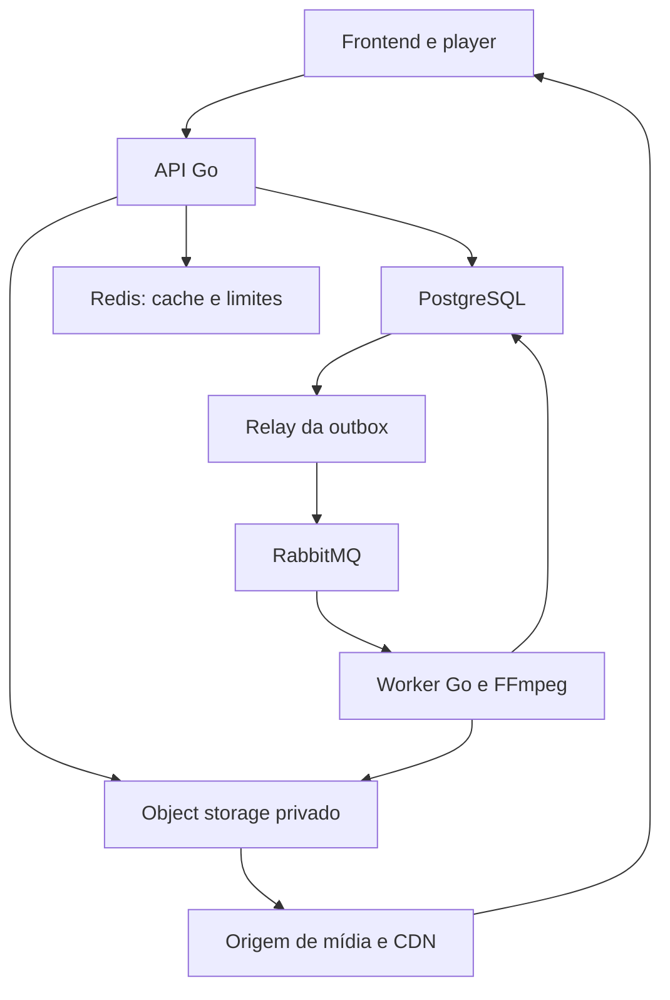
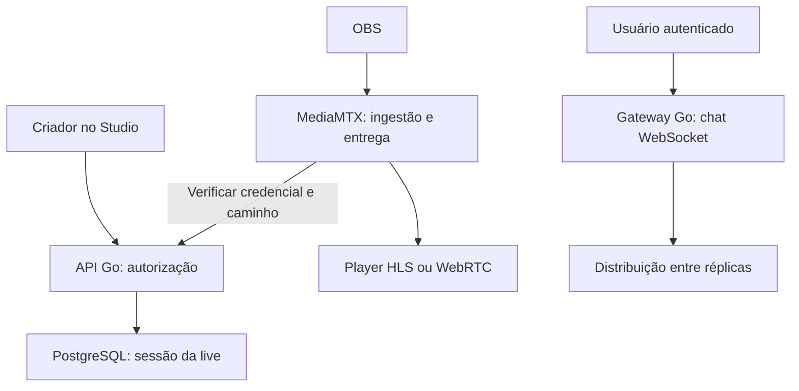
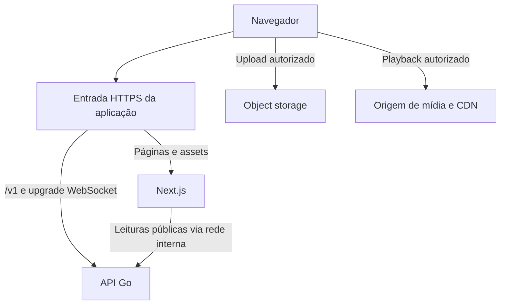
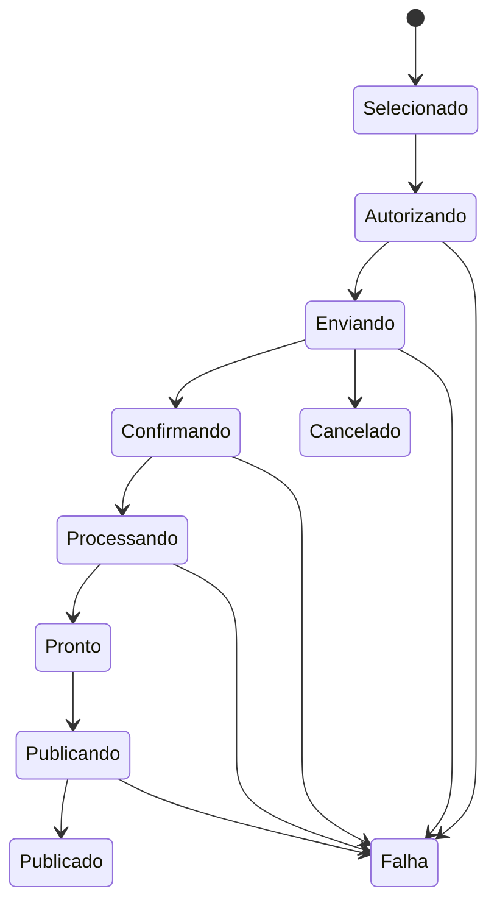

# GoTube — formação full stack em Go e Next.js

## Do primeiro programa a uma plataforma de vídeos e lives

**Edição:** 14/10/2026, revisão 2 — frontend integrado. **Idioma:** português. **Formato:** curso autoral baseado em projeto, com explicações, aulas sequenciais, laboratórios, especificações e avaliações.

**Mapa da formação:** Parte I, seções 1–20: backend Go, 32 módulos, 324 horas. Parte II, seções 21–34: frontend Next.js, 24 módulos, 192 horas. **Total: 56 módulos e 516 horas estimadas**, incluindo prática. A 12 horas semanais, aproximadamente 43 semanas. A trilha frontend segue os mesmos sete passos pedagógicos e constrói as telas conectadas à API Go. Este arquivo reúne as duas trilhas; não contém uma aplicação inteira já implementada.

Este material organiza os seis pilares solicitados. Não é reprodução nem material oficial do treinamento comercial Go Expert. O resultado planejado é uma plataforma educacional inspirada nas funcionalidades básicas do YouTube, com identidade própria. A entrega deste documento é o curso e a especificação de implementação; o produto completo será construído nos exercícios. Os trechos identificados como laboratórios podem ser executados isoladamente. Os demais exemplos ilustram contratos e decisões, não um repositório pronto para produção.

## 1. Como estudar

O objetivo é aprender a explicar **por que o programa funciona**, como ele falha e como medir suas limitações. Não basta copiar um handler ou subir containers.

Para cada assunto, responda a sete perguntas:

1. Qual problema concreto do GoTube estamos resolvendo?
2. Qual conceito de Go é necessário?
3. O que acontece na memória, no runtime, no processo ou na rede?
4. Qual é a implementação mais simples que preserva as regras?
5. Como ela falha com concorrência, entradas inválidas ou indisponibilidade?
6. Como testar e medir o comportamento?
7. Quando trocar a solução e qual é o custo da troca?

Use um ciclo de aula de aproximadamente 2 horas: leitura e desenho do problema, implementação pequena, testes, experimento de falha e anotação do aprendizado. Laboratórios maiores podem exigir vários ciclos. Reserve tempo para refatoração; não avance apenas porque o caminho feliz funcionou.

**Pré-requisitos:** lógica de programação, terminal, Git e HTTP básico. Quem já usa Laravel, Node ou Bun deve prestar atenção às diferenças: Go não usa promises como modelo padrão, erros fazem parte dos retornos, interfaces são satisfeitas implicitamente e concorrência não torna automaticamente uma operação durável.

### Carga estimada, não promessa de conclusão

| Pilar | Horas de estudo e prática | Evidência de domínio |
|---|---:|---|
| 1. Fundamentos da linguagem | 48 | Domínio de vídeos, CLI e HTTP inicial |
| 2. Testes automatizados | 40 | Testes unitários, integração, fuzz e E2E |
| 3. Desenvolvimento de APIs | 80 | Plataforma funcional com persistência e mídia |
| 4. Performance e concorrência | 56 | Pipeline limitado, durável e mensurado |
| 5. Go e Clean Architecture | 48 | Módulos, adaptadores, contratos e deploy |
| 6. Golang Internals | 40 | Relatório de memória, scheduler e profiling |
| Complementos profissionais | 12 | Portfólio, colaboração e plano de produto |
| **Subtotal da trilha Go** | **324** | **Projeto demonstrável e documentado** |

A 12 horas por semana, a estimativa é 27 semanas. Os pilares se intercalam: testes começam no primeiro módulo, arquitetura evolui junto com o código e performance é medida antes de qualquer otimização.

## 2. O produto que será construído

### Personas e permissões

| Papel | Pode fazer |
|---|---|
| Visitante | Buscar e assistir conteúdo público; consultar canais |
| Usuário autenticado | Comentar, curtir, inscrever-se, criar playlists e manter histórico |
| Criador | Gerenciar seu canal, enviar vídeos e iniciar suas lives |
| Moderador | Tratar denúncias e ocultar conteúdo com justificativa e auditoria |
| Administrador | Administrar categorias, usuários e políticas; sem acesso a senhas |

Criador é uma capacidade de uma conta com canal. Não crie duas identidades para a mesma pessoa. Toda mutação deve verificar a identidade autenticada e a propriedade do recurso no servidor.

### Escopo funcional e aceite

| ID | Funcionalidade | Critério observável |
|---|---|---|
| RF01 | Cadastro e autenticação | E-mail único, hash de senha, login, logout e renovação de sessão |
| RF02 | Recuperação de acesso | Token aleatório, expirável, de uso único; resposta sem revelar se a conta existe |
| RF03 | Perfil e canal | Editar nome, descrição e avatar; handle único |
| RF04 | Cadastros básicos | CRUD de categorias para admin; perfil e canal para proprietário |
| RF05 | Upload de vídeo | Sessão autorizada, limite de tamanho, progresso e validação do objeto recebido |
| RF06 | Processamento | Extrair metadados, gerar thumbnail e HLS; mostrar falha e permitir retry autorizado |
| RF07 | Reprodução | Player com play, pause, seek, volume, tela cheia e seleção de qualidade |
| RF08 | Edição e exclusão | Editar título/descrição/visibilidade; exclusão bloqueia reprodução e agenda limpeza |
| RF09 | Comentários | Criar, paginar, editar próprio comentário e excluir conforme permissão |
| RF10 | Curtidas | Curtir e descurtir de forma idempotente, sem duplicar contagem |
| RF11 | Inscrições | Inscrever/desinscrever em canal; listar feed de inscrições |
| RF12 | Catálogo e busca | Buscar por título, filtrar categoria e paginar com ordenação estável |
| RF13 | Histórico | Salvar posição por usuário/vídeo e retomar com limite na duração |
| RF14 | Playlists | Criar, reordenar, adicionar/remover vídeos; aplicar privacidade |
| RF15 | Lives | Criar transmissão, emitir credencial, publicar via OBS e assistir pelo navegador |
| RF16 | Chat ao vivo | Autenticar conexão, limitar frequência e moderar mensagens |
| RF17 | Notificações | Vídeo processado, falha e atividade relevante; leitura por usuário |
| RF18 | Moderação | Denúncia, revisão, ocultação e trilha de auditoria |

**Fora da primeira versão:** anúncios, pagamento a criadores, DRM, Content ID, recomendação por machine learning, escala global equivalente ao YouTube, edição de vídeo no navegador e live multiparty. Esses itens precisam de outros projetos e recursos operacionais.

### Telas e menus

| Área | Telas e comportamentos |
|---|---|
| Navegação principal | Logo, busca, início, explorar, inscrições, biblioteca e perfil |
| Autenticação | Cadastro, login, recuperação e redefinição de senha |
| Catálogo | Grid de thumbnails, duração, canal e estado vazio/erro/carregando |
| Assistir | Player, título, descrição, canal, inscrever-se, curtir, comentários e relacionados simples |
| Canal | Cabeçalho, vídeos públicos, playlists e aba ao vivo |
| Biblioteca | Histórico, continuar assistindo, curtidos e playlists |
| Studio | Lista de vídeos, upload, edição, estado de processamento e exclusão |
| Studio Live | Agendar/criar, visualizar instruções OBS, rotacionar chave, status e encerrar |
| Administração | Categorias, denúncias e registros de moderação |

Frontend adotado: Next.js, TypeScript, Tailwind, React Hook Form e Zod, com a trilha completa nas seções 21–34. Validação no navegador melhora a experiência; todas as regras são verificadas novamente em Go. Os templates HTML do início permanecem como laboratório curto para entender HTTP antes de adicionar o frontend.

## 3. Arquitetura de referência

Começaremos com **monólito modular**. API, worker e publicador da outbox podem compartilhar o mesmo módulo Go e ter executáveis distintos. Isso permite escalar processamento de mídia sem distribuir prematuramente todas as regras de negócio.



O desenho representa dependências e fluxo de dados, não autoriza leitura pública direta do bucket. Upload usa autorização limitada; reprodução passa por uma política de acesso própria.



### Componentes e motivo de uso

| Componente | Escolha didática | Motivo e limite |
|---|---|---|
| API | Go, net/http e depois chi | Entender padrão HTTP antes de conveniências de roteamento |
| Dados | PostgreSQL, pgx, SQL e depois sqlc | SQL explícito, transações e queries observáveis |
| ORM | GORM em laboratório comparativo | Compreender produtividade, SQL gerado e N+1 |
| Cache | Redis, introduzido após medir | Cache e coordenação auxiliar; não substitui fonte durável |
| Fila | RabbitMQ | Retries e distribuição de trabalho entre processos |
| Vídeos | S3 ou serviço compatível no laboratório | Arquivos grandes fora do banco e do disco efêmero da API |
| Transcodificação | FFmpeg e ffprobe | Go supervisiona os processos; codecs ficam no motor especializado |
| Live | MediaMTX e OBS | Praticar ingestão, autenticação e entrega sem escrever um servidor de mídia do zero |
| Player | HTML video e integração HLS | HLS nativo quando suportado, biblioteca no restante |
| Observabilidade | slog, Prometheus, OpenTelemetry | Logs estruturados, métricas e rastreamento entre etapas |
| Configuração | Env tipado; Viper em comparação | Falhar no boot quando faltar configuração obrigatória |
| DI | Construtores explícitos | Dependências visíveis e fáceis de testar |

**Atualização importante:** o repositório original Google Wire foi arquivado e informa não ser mais mantido. O curso inclui Wire para leitura de projetos legados e comparação, mas a implementação principal utiliza DI manual. Registre versões exatas de Go, módulos, imagens, FFmpeg e MediaMTX no repositório; não dependa de tags `latest` no ambiente reproduzível. [S7]

### Organização progressiva

Não crie todas as pastas antes de entender os primeiros casos de uso. Evolua para:

```text
cmd/api/main.go
cmd/worker/main.go
cmd/outbox/main.go
cmd/gotube/main.go
internal/identity/
internal/channel/
internal/video/
internal/social/
internal/live/
internal/notification/
internal/platform/config/
internal/platform/postgres/
internal/platform/rabbitmq/
internal/platform/storage/
internal/platform/observability/
api/openapi.yaml
api/proto/
db/migrations/
db/queries/
deploy/compose/
deploy/kubernetes/
docs/adr/
docs/runbooks/
web/
```

Dentro de um módulo de negócio, separe entidade, caso de uso e adaptadores quando houver uma necessidade real. Não crie uma interface para toda struct nem uma pasta genérica `utils` para regras de negócio.

## 4. Sequência completa de aulas e laboratórios

Cada módulo contém uma pequena explicação, sequência de aulas, implementação, falha a investigar e condição de conclusão. Os apêndices aprofundam os fluxos mais importantes.

### M01 — História, instalação e ferramenta de trabalho · Pilar 1 · 6 h

Go foi desenvolvido no Google e apresentado publicamente em 2009. Sua proposta combina compilação, tipagem estática, ferramentas padronizadas e suporte direto à concorrência. O benefício no nosso projeto será manter serviços simples de operar, com tratamento explícito de erros e concorrência controlada.

**Aulas:** 1. Compilado versus interpretado e o papel do runtime. 2. Instalação pela distribuição oficial. 3. VSCode, extensão Go, gopls e debugger Delve. 4. `go version`, `go env`, `go run`, `go build`, `go test`, `go fmt` e `go vet`. 5. Como ler documentação e mensagens do compilador.

**Prática:** criar `gotube`, iniciar `go mod init example.com/gotube` e implementar um programa que imprime o nome do projeto e lê um título pelo terminal. Rodar, compilar e executar o binário sem `go run`.

**Investigue:** modificar um arquivo e executar o binário antigo. Explique por que a mudança não apareceu. **Aceite:** outro desenvolvedor consegue reproduzir os comandos pelo README. **Exercício:** documentar a versão exata e o sistema operacional usados.

### M02 — Tipos, valores e controle de fluxo · Pilar 1 · 6 h

Variáveis possuem tipos; o compilador impede várias combinações incoerentes. O valor zero evita parte da inicialização manual, mas não garante validade de negócio: uma duração zero pode ser um valor válido em memória e inválido para um vídeo publicado.

**Aulas:** 1. `var`, `:=`, constantes e conversões. 2. Inteiros, floats, bool, string, byte e rune. 3. `if`, `switch`, `for` e `range`. 4. Escopo e shadowing. 5. UTF-8: bytes não equivalem a caracteres visíveis.

**Prática:** validar título, descrição e duração. Criar tipos `VideoID` e `Visibility`. Usar `time.Duration` para timeouts e unidade explícita para duração persistida.

**Investigue:** validar tamanho de título com acentos usando `len`. **Aceite:** testes deixam clara a política escolhida, incluindo Unicode e espaços. **Exercício:** impedir categorias vazias e títulos compostos apenas de espaços sem destruir o texto original do usuário.

### M03 — Arrays, slices e maps · Pilar 1 · 8 h

Array inclui seu tamanho no tipo. Slice descreve uma janela sobre um array subjacente; copiar um slice não clona seus elementos. Map associa chaves a valores e não oferece sincronização automática para escritas concorrentes.

**Aulas:** 1. `len` e `cap`. 2. `make`, `append` e crescimento. 3. Aliasing entre slices. 4. Cópia com `copy`. 5. Map lookup com `value, ok`. 6. Ordem de iteração não garantida. 7. Slice nil versus vazio ao serializar.

**Prática:** catálogo em memória e índice por ID. Criar filtros por categoria, ordenação explícita e paginação.

**Investigue:** modificar uma thumbnail por meio de um slice compartilhado; depois executar acesso concorrente ao map com race detector. **Aceite:** não retornar referências mutáveis ao estado interno sem contrato claro. **Exercício:** comparar alocações ao montar uma lista com e sem capacidade inicial conhecida.

### M04 — Funções, ponteiros, structs e métodos · Pilar 1 · 8 h

Go passa argumentos por valor. Quando esse valor é um ponteiro, duas partes do programa podem alcançar o mesmo objeto. Ponteiro não significa que o objeto necessariamente está no heap; isso depende, entre outros fatores, da análise de escape.

**Aulas:** 1. Retornos múltiplos. 2. Funções de primeira classe e closures. 3. `&` e `*`. 4. Structs e composição. 5. Receiver por valor e por ponteiro. 6. Visibilidade por identificador exportado. 7. Métodos preservando invariantes.

**Prática:** entidade Video com métodos para editar título e publicar somente quando o processamento terminou. Criar construtor que rejeita estado inválido.

**Investigue:** copiar uma struct que contém slice; explicar por que a cópia ainda compartilha elementos. **Aceite:** publicação não pode ser forçada apenas alterando DTO de entrada. **Exercício:** separar metadados editáveis pelo criador dos campos calculados pelo processamento.

### M05 — Interfaces, generics e erros · Pilar 1 · 8 h

Uma interface descreve comportamento e é satisfeita implicitamente. Defina interfaces pequenas onde são consumidas. Generics são úteis quando um algoritmo deve preservar tipos sem duplicação; não substituem modelagem de domínio. Erros são valores e precisam carregar contexto sem expor detalhes internos ao cliente.

**Aulas:** 1. Interfaces e method sets. 2. Interface nil versus ponteiro nil dentro de interface. 3. `errors.Is` e `errors.As`. 4. `%w` e encadeamento. 5. `defer`, avaliação dos argumentos e ordem LIFO. 6. `panic/recover` em fronteiras. 7. Type parameters e constraints.

**Prática:** interface `VideoReader`, repositório em memória e função genérica de paginação de coleções locais. Não force um repositório CRUD genérico para todos os módulos.

**Investigue:** retornar `(*RepositoryError)(nil)` como `error`. **Aceite:** erro de domínio vira HTTP adequado sem comparar texto de mensagem. **Exercício:** remover `panic` de uma validação de entrada e preservar contexto do erro.

### M06 — Packages, módulos, workspaces e compilação · Pilar 1 · 6 h

Package é unidade de organização e compilação; módulo define um conjunto versionado de packages. Workspace coordena múltiplos módulos durante desenvolvimento. Um projeto com API e worker não precisa de múltiplos módulos apenas por possuir vários executáveis.

**Aulas:** 1. Import path e `internal`. 2. `go.mod` e `go.sum`. 3. `go mod tidy`. 4. Dependências diretas e indiretas. 5. Módulos privados e `GOPRIVATE`. 6. `go.work`. 7. Cross compilation e limites de CGO.

**Prática:** mover a entidade para `internal/video`, criar CLI e API consumindo o mesmo domínio. Abrir um laboratório separado com dois módulos e `go work`.

**Investigue:** publicar um import com caminho incorreto ou vazar dependência local via `replace`. **Aceite:** clone limpo compila sem caminhos absolutos da máquina. **Exercício:** documentar acesso ao módulo privado sem gravar tokens no Git.

### M07 — Testes unitários e design testável · Pilar 2 · 10 h

Um teste deve verificar uma regra que pode falhar, não repetir a implementação. Use tabelas de casos para entradas representativas e subtestes para nomear cenários. Um fake em memória costuma ser suficiente para testar um caso de uso; mocks verificam interações apenas quando a interação é parte do contrato.

**Aulas:** 1. `testing.T`. 2. Table-driven tests. 3. `t.Run`, `t.Helper`, `t.Cleanup`. 4. `t.Parallel` e isolamento. 5. Fakes, stubs e mocks. 6. Testify e suites como alternativas. 7. Cobertura interpretada por risco.

**Prática:** testar título inválido, dono incorreto, vídeo não pronto e publicação válida. Injetar relógio quando o tempo for uma regra; não usar sleeps para simular validade de sessão.

**Investigue:** testes que passam isoladamente e falham em lote por compartilhar estado global. **Aceite:** testes determinísticos e independentes. **Exercício:** introduzir uma regressão de autorização e provar que o teste falha.

### M08 — Arquivos, JSON, HTTP e templates · Pilar 3 · 8 h

HTTP carrega bytes, cabeçalhos, métodos e status; structs Go não atravessam a rede diretamente. O handler decodifica uma representação, chama uma regra e codifica a resposta. Recursos de I/O precisam de limites e fechamento apropriado.

**Aulas:** 1. `io.Reader/Writer`. 2. `os` e arquivos. 3. JSON tags, encode/decode e campos desconhecidos. 4. HTTP client reutilizável com timeout. 5. Server e ServeMux. 6. File server e diretório permitido. 7. `html/template` e escape contextual.

**Prática:** construir Busca CEP como exercício isolado de cliente HTTP, usando servidor falso nos testes; depois criar catálogo HTML e API JSON. Verificar status de upstream, limite de leitura e fechamento de body.

**Investigue:** carregar arquivo grande com `io.ReadAll` versus streaming. **Aceite:** não servir o diretório do projeto inteiro. **Exercício:** rejeitar mais de um objeto JSON no corpo e limitar tamanho do request.

### M09 — Context e ciclo de vida · Pilar 3 · 6 h

Context propaga cancelamento, prazo e valores restritos ao escopo da operação. Ele sinaliza; não interrompe à força uma função que o ignora. Use como primeiro argumento e não como recipiente genérico de dependências. [S3]

**Aulas:** 1. Background e TODO. 2. Cancel, timeout e deadline. 3. `Done` e `Err`. 4. Propagação para HTTP e banco. 5. Chaves tipadas para metadados de request. 6. Cancelamento cooperativo. 7. Context de request versus trabalho persistente.

**Prática:** cancelar Busca CEP e consulta lenta; testar que o handler deixa de esperar. Criar job persistido para transcodificar, com context próprio no worker.

**Investigue:** iniciar `go transcode(r.Context())` e retornar 202; observar o cancelamento ao terminar o request. Trocar por `Background` não resolve perda no restart. **Aceite:** todo trabalho possui dono, limite e estratégia de encerramento. **Exercício:** verificar liberação de conexão após deadline.

### M10 — APIs REST, chi e OpenAPI · Pilar 3 · 10 h

O router decide qual handler recebe a requisição; middleware envolve o processamento. Regras de negócio não devem depender de chi. A comparação com outros frameworks serve para avaliar integração, custo de migração e legibilidade, não para escolher por um benchmark isolado.

**Aulas:** 1. Rotas e parâmetros. 2. chi e grupos. 3. Request ID, logs, recovery e limites. 4. CORS explícito. 5. Status e erros padronizados. 6. Paginação e filtros. 7. OpenAPI e Swagger UI.

**Prática:** implementar criar, listar, consultar, editar e excluir metadados de vídeos. Limitar `page_size`; ordenar por `(created_at, id)` para desempate. Documentar autenticação, schemas e erros.

**Investigue:** cursor que perde itens com datas repetidas. **Aceite:** contrato distingue 400, 401, 403/404 conforme política, 409, 413, 422 e 503. **Exercício:** alterar um contrato e identificar incompatibilidade antes de mudar o frontend.

### M11 — Banco, migrations, SQLC e GORM · Pilar 3 · 12 h

Pool limita conexões; não crie uma conexão independente por consulta. Transações tornam um conjunto de alterações atômico dentro do banco, mas não englobam automaticamente broker e storage. SQL explícito ajuda a enxergar filtros de autorização, índices e custo de paginação.

**Aulas:** 1. `database/sql`, drivers e pgx. 2. Pool e orçamento de conexões. 3. Queries parametrizadas. 4. Context em queries. 5. Migrations versionadas. 6. sqlc e código gerado. 7. GORM, N+1 e comparação prática.

**Prática:** persistir usuários, canais e vídeos; colocar constraints no banco. Reimplementar uma query em SQL/pgx, sqlc e GORM e comparar SQL gerado, ergonomia e testes.

**Investigue:** `SELECT` seguido de `INSERT` para like sob duas requisições simultâneas. **Aceite:** unicidade garantida pelo banco. **Exercício:** somar pools de todas as réplicas, workers e operações administrativas e ajustar o orçamento do PostgreSQL.

### M12 — Autenticação, JWT e sessões · Pilar 3 · 10 h

JWT assinado comprova integridade das claims; não cifra seu conteúdo. Identidade e autorização são decisões distintas. A assinatura válida não dá ao usuário permissão para editar qualquer vídeo.

**Aulas:** 1. Cadastro e normalização de identidade. 2. Hash adaptativo de senha com biblioteca estabelecida. 3. Access token curto. 4. Refresh opaco, aleatório e armazenado por hash. 5. Rotação e revogação. 6. Autorização por proprietário e papel. 7. Recuperação de senha e proteção contra abuso.

**Prática:** cadastro, login, refresh e logout com sessão persistida. Verificar algoritmo permitido, assinatura, emissor, audiência, expiração e claims obrigatórias; nunca confiar em claims apenas decodificadas. Para aplicação web, manter access token em memória e refresh em cookie HttpOnly/Secure; desenhar SameSite, CORS e proteção CSRF conforme a topologia.

**Investigue:** duas renovações simultâneas e detecção de reutilização. Serializar refresh no cliente e definir atomicidade no banco, sem invalidar sessões legítimas por uma política mal especificada. **Aceite:** conta A não altera recursos de B, mesmo conhecendo IDs. **Exercício:** logout revoga refresh; documentar que access token emitido pode continuar válido até expirar, a menos que haja verificação adicional de sessão.

### M13 — Upload direto e object storage · Pilar 3 · 8 h

A API autoriza o upload, mas não precisa transportar todos os bytes. Uma URL assinada concede uma operação limitada por objeto e tempo. Ela não substitui a verificação de que o objeto existe e atende à política após o envio.

**Aulas:** 1. Bucket e object key. 2. Upload único e multipart. 3. URLs assinadas. 4. Progresso no navegador. 5. Finalização e verificação. 6. Quotas e limpeza de uploads abandonados. 7. Segurança de arquivos.

**Prática:** sessão de upload vinculada a usuário, vídeo, key gerada no servidor, prazo e tamanho esperado. Ao completar, confirmar metadados no storage, iniciar inspeção e persistir evento na mesma transação da mudança de estado.

**Investigue:** cliente mentindo sobre MIME, tamanho, duração e sucesso. Não trate extensão como prova. **Aceite:** ninguém substitui o objeto de outro usuário nem publica antes da inspeção. **Exercício:** upload interrompido não mantém partes abandonadas indefinidamente.

### M14 — Transcodificação, thumbnails e player · Pilar 3 · 10 h

Um arquivo MP4 enviado pelo criador pode usar codec inadequado para o navegador. Transcodificar gera representações compatíveis; empacotar HLS cria playlists e segmentos. Bitrate adaptativo exige variantes alinhadas e player capaz de alterná-las, não apenas arquivos com resoluções diferentes.

**Aulas:** 1. Container versus codec. 2. ffprobe. 3. FFmpeg por processo supervisionado. 4. HLS VOD. 5. Variantes e keyframes alinhados. 6. Thumbnails. 7. Player e autorização de mídia.

**Prática:** gerar inicialmente uma rendition; depois 360p, 720p e 1080p somente quando a origem justificar. Preservar proporção, tratar rotação e ausência de áudio. Subir segmentos antes de publicar o manifesto final.

**Investigue:** manifest publicado antes dos segmentos; vídeo sem áudio falhando por mapeamento obrigatório; processo consumindo toda CPU. **Aceite:** vídeo só fica pronto após validação dos artefatos. **Exercício:** comparar tempo de processamento, tamanho final e qualidade visual em amostras próprias.

### M15 — Comentários, likes, inscrições e histórico · Pilar 3 · 8 h

Like é uma relação, não apenas um contador. Se o usuário repete a operação por timeout, o resultado deve continuar representando uma curtida. Contagens e feeds podem ser projeções, mas a fonte da relação precisa permanecer consistente.

**Aulas:** 1. Operações idempotentes. 2. Constraints compostas. 3. Paginação de comentários. 4. Edição e exclusão autorizada. 5. Inscrições e feed. 6. Histórico com debounce no cliente. 7. Playlists ordenadas.

**Prática:** `PUT/DELETE like`, comentários e progresso de reprodução. Salvar posição com sessão/seq para evitar que eventos antigos da mesma sessão sobrescrevam os novos; documentar política entre dispositivos.

**Investigue:** incrementar contador mesmo quando `INSERT ... ON CONFLICT DO NOTHING` não inseriu linha. **Aceite:** retries não duplicam likes. **Exercício:** comentário de vídeo removido não continua disponível por endpoint alternativo.

### M16 — Lives, OBS e chat · Pilar 3 · 8 h

Live possui plano de controle e plano de mídia. Go cria sessão, autoriza publicação e modera chat. O servidor de mídia recebe e entrega áudio/vídeo. MediaMTX oferece publicação por protocolos suportados e mecanismos de autenticação que devem ser configurados para a versão fixada. [S8][S9]

**Aulas:** 1. RTMP, HLS, WebRTC e WHIP. 2. OBS e configuração de encoder. 3. Chave de stream. 4. Autorização por caminho e ação. 5. Eventos de conexão/desconexão. 6. Chat WebSocket. 7. Reconexão, gravação e replay.

**Prática:** criar live, emitir credencial aleatória, enviar pelo OBS, abrir player e encerrar. HLS é a primeira entrega; WebRTC entra como comparação de latência e complexidade de rede. Testar codecs reais do OBS com o player escolhido.

**Investigue:** desconexão temporária não deve encerrar permanentemente a sessão sem período de tolerância. **Aceite:** credencial revogada não permite nova publicação; encerramento também interrompe publicação ativa por mecanismo de controle. **Exercício:** colocar dois servidores de chat e verificar se mensagens chegam a espectadores de ambas as réplicas.

### M17 — Goroutines e concorrência estruturada · Pilar 4 · 8 h

Goroutine é uma execução concorrente gerenciada pelo runtime. Não corresponde permanentemente a uma thread do sistema operacional. Concorrência organiza tarefas sobrepostas; paralelismo executa trabalho simultaneamente quando há recursos. Criar mais goroutines não cria capacidade infinita.

**Aulas:** 1. `go` e ciclo de vida. 2. WaitGroup. 3. Cancelamento compartilhado. 4. Erros de tarefas paralelas. 5. Limite de concorrência. 6. CPU-bound versus I/O-bound. 7. Graceful shutdown.

**Prática:** coletar metadados independentes com limite, esperando todas as tarefas necessárias e cancelando quando apropriado. Cada tarefa precisa ter uma saída previsível.

**Investigue:** retornar do `main` com tarefas abertas; criar uma goroutine por item de um catálogo enorme. **Aceite:** não há execução abandonada nem concorrência sem limite. **Exercício:** medir 1, 2, 4 e 8 tarefas simultâneas com o mesmo conjunto de entradas.

### M18 — Channels, select e workers · Pilar 4 · 10 h

Channels comunicam e sincronizam. Um channel sem buffer precisa de encontro entre envio e recepção; com buffer, absorve uma quantidade finita de trabalho. Buffer adia pressão, mas não resolve produção permanentemente maior que consumo.

**Aulas:** 1. Send e receive. 2. Direções de channel. 3. `close` pelo responsável pelo envio. 4. `range` até encerramento. 5. `select` e cancelamento. 6. Fan-out/fan-in. 7. Backpressure.

**Prática:** laboratório executável do apêndice A. Implementar fila local limitada e workers fixos; observar que resultados chegam fora da ordem de entrada.

**Investigue:** channel nil bloqueando; envio em channel fechado; consumidor que deixa de receber sem cancelar. **Aceite:** cancelamento permite encerramento de produtores e workers. **Exercício:** adicionar resultado ordenado usando índice, sem perder limitação de memória.

### M19 — Mutex, atomics e modelo de memória · Pilar 4 · 8 h

Uma race acontece quando acessos conflitantes à mesma memória não são sincronizados adequadamente. `counter++` envolve leitura e escrita. Um contador atômico protege essa operação, mas não torna uma regra composta sobre vários campos automaticamente consistente. As garantias de visibilidade precisam de sincronização. [S2]

**Aulas:** 1. Mutex e região crítica. 2. RWMutex e contenção. 3. Atomics tipados. 4. Não copiar mutex em uso. 5. Relação happens-before. 6. Race detector. 7. Estado local versus distribuído.

**Prática:** reproduzir race em contador e corrigi-la de duas formas. Modelar cache local protegido. Para like entre réplicas, usar transação e constraint no banco.

**Investigue:** usar mutex da API para proteger operações executadas em duas réplicas distintas. **Aceite:** aluno explica por que esse lock não coordena processos diferentes. **Exercício:** reduzir região crítica sem mover dados compartilhados para fora da proteção.

### M20 — RabbitMQ, outbox, retries e idempotência · Pilar 4 · 12 h

Fila durável atende uma necessidade diferente de channel: trabalho atravessa processos e reinícios. Confirmação de publicação e confirmação de consumo resolvem etapas distintas. A falha entre executar o efeito e enviar ACK pode causar redelivery, portanto o consumidor precisa tolerar duplicidade. [S6]

**Aulas:** 1. Exchange, routing key, queue e binding. 2. Mensagens persistentes e filas duráveis. 3. Publisher confirms. 4. ACK/NACK e prefetch. 5. Outbox transacional. 6. Retry limitado, atraso e DLQ. 7. Deduplicação, leases e fencing.

**Prática:** persistir `VideoUploaded` junto com o estado; relay publica e só marca o evento após confirmação. Worker registra progresso por job e geração de vídeo, produz artefatos versionados e conclui com atualização condicional.

**Investigue:** derrubar processo após publicação antes de marcar outbox e após resultado antes de ACK. **Aceite:** ambas as duplicações são seguras. **Exercício:** mensagem inválida vai para tratamento de erro, sem loop infinito de requeue.

### M21 — Performance, carga e balanceamento · Pilar 4 · 10 h

Performance tem várias dimensões: throughput, latência, memória, disponibilidade e custo. Uma API de metadados rápida não garante player rápido se a entrega de segmentos estiver saturada. Meça API, pipeline e mídia separadamente.

**Aulas:** 1. p50/p95/p99. 2. Throughput e erros. 3. Teste de carga, estresse e soak. 4. Pool de banco e cache. 5. Balanceador HTTP. 6. Réplicas de workers por backlog e recursos. 7. Orçamento de CPU do FFmpeg.

**Prática:** benchmark baseline, identificar gargalo, alterar uma variável e repetir. Um worker pode executar FFmpeg multithread; limite de jobs deve considerar threads e RAM de cada processo.

**Investigue:** aumentar réplicas até esgotar conexões de banco. **Aceite:** relatório inclui máquina, dados, concorrência, warm-up, duração, erros e percentis. **Exercício:** explicar por que aumentar GOMAXPROCS não resolve banco lento.

### M22 — Integração e testes de contrato · Pilar 2 · 10 h

Mocks não comprovam que a query funciona no PostgreSQL. Integração verifica fronteiras reais; testes de contrato verificam expectativas entre produtor e consumidor. Preserve velocidade da suíte separando conjuntos e preparando dados de forma isolada.

**Aulas:** 1. `httptest`. 2. Banco de teste e migrations. 3. Containers efêmeros ou Compose. 4. Contratos OpenAPI. 5. Broker e storage reais no laboratório. 6. Autorização adversarial. 7. Execução em lote.

**Prática:** integração de transação outbox e concorrência de likes; contrato do evento versionado. Adicionar teste que cancela query e verifica retorno dentro de limite razoável.

**Investigue:** fake aceitando comportamento que banco real rejeita. **Aceite:** rollback não deixa evento órfão. **Exercício:** simular queda do broker sem perder estado de upload concluído.

### M23 — Fuzzing, mutação e benchmarking · Pilar 2 · 10 h

Fuzzing gera entradas para encontrar violações de propriedades; guarde entradas que reproduzem falhas. Mutação altera intencionalmente comportamento para verificar se os testes detectam regressões. Benchmark mede um recorte e exige ambiente comparável. [S5]

**Aulas:** 1. `testing.F`. 2. Seed corpus. 3. Parsers e round-trip. 4. Mutação manual e ferramenta opcional. 5. `testing.B`. 6. `-benchmem`. 7. Comparação estatística e efeitos do ambiente.

**Prática:** fuzz do cursor opaco e normalização de slug; benchmark de listagem local e serialização. Não faça rede externa no fuzz. Mutar verificação de proprietário e provar detecção.

**Investigue:** teste com cobertura alta sem nenhuma asserção útil. **Aceite:** corpus inclui erro descoberto e teste de regressão. **Exercício:** distinguir otimização real de ruído em três execuções.

### M24 — E2E e recuperação de falhas · Pilar 2 · 10 h

O E2E liga a experiência do usuário ao resultado persistido. Use poucas jornadas importantes e teste falhas onde perda de dados ou acesso indevido seriam graves. Não substitua todos os testes por uma suíte lenta de navegador.

**Aulas:** 1. Jornadas de usuário. 2. Fixtures de vídeo. 3. Polling com prazo em vez de sleeps arbitrários. 4. Reset de ambiente. 5. Queda de worker. 6. Recuperação e replay. 7. Testes de privacidade da mídia.

**Prática:** cadastrar, entrar, enviar vídeo pequeno, aguardar READY, assistir, comentar, curtir, remover e provar que o conteúdo não pode mais ser acessado conforme a política de cache/token definida.

**Investigue:** playlist privada bloqueada, mas segmentos continuam públicos. **Aceite:** testes cobrem acesso direto à mídia, não somente endpoint de metadados. **Exercício:** reiniciar o worker no meio de um processamento e demonstrar recuperação sem publicação parcial.

### M25 — SOLID e Clean Architecture idiomática · Pilar 5 · 12 h

A arquitetura protege regras de negócio das decisões de transporte e persistência. Em Go, composição e interfaces pequenas ajudam a alcançar esse objetivo sem copiar hierarquias de frameworks orientados a classes.

**Aulas:** 1. Fragilidade e custo de mudança. 2. SRP: motivos de mudança. 3. OCP com pontos reais de extensão. 4. LSP como respeito ao contrato comportamental. 5. ISP com interfaces pequenas. 6. DIP e adaptadores. 7. Entities, DTOs, input/output e use cases.

**Prática:** separar `PublishVideo` do handler, SQL e broker. O domínio valida se o vídeo pode ser publicado; o adaptador carrega e persiste. `context.Context` pode aparecer nas fronteiras de aplicação e I/O, sem obrigar entidades puras a conhecê-lo.

**Investigue:** `Video` importando GORM ou chi por conveniência. **Aceite:** caso de uso pode ser testado sem servidor HTTP. **Exercício:** trocar repositório em memória pelo SQL mantendo o mesmo teste comportamental do caso de uso.

### M26 — Unit of Work, DI, eventos, Cobra e Viper · Pilar 5 · 10 h

Unit of Work define a fronteira transacional. DI explicita como as dependências chegam ao caso de uso. Event Dispatcher local executa handlers no processo e não garante entrega após queda. Esses conceitos se complementam, mas não são equivalentes.

**Aulas:** 1. Transação por caso de uso. 2. Repositórios usando a mesma transação. 3. Construtores e composition root. 4. Wire como estudo legado. 5. Dispatcher e handlers. 6. Cobra para comandos. 7. Viper versus configuração tipada.

**Prática:** comandos `serve`, `worker`, `outbox`, `reprocess-video` e `version`. Configurar precedência de flags/env/arquivo explicitamente. O CLI usa os mesmos casos de uso e checks de autorização administrativa.

**Investigue:** um repositório usa transação, outro usa pool e confirma fora dela. **Aceite:** rollback reverte todas as mudanças locais previstas. **Exercício:** falhar no boot se bucket ou URL do banco não estiver configurado.

### M27 — gRPC, GraphQL e documentação · Pilar 5 · 10 h

REST será o contrato principal do frontend. gRPC permite explorar protobuf e RPC tipado; GraphQL permite explorar seleção de campos e agregação. Adicionar todos como requisitos de produção sem necessidade aumenta superfície e manutenção.

**Aulas:** 1. Protobuf e geração. 2. Deadline e códigos gRPC. 3. Unary e streaming. 4. GraphQL schema/resolver. 5. N+1 e batching. 6. Limites de complexidade. 7. Go Doc e documentação de contratos.

**Prática:** expor consulta interna de estado de processamento em gRPC e catálogo somente leitura em GraphQL. Reutilizar aplicação, não chamar diretamente tabelas contornando autorização.

**Investigue:** query GraphQL pequena em bytes mas cara em profundidade e fan-out. **Aceite:** consulta limitada, deadline propagado e contratos documentados. **Exercício:** registrar ADR explicando se cada protocolo ficará ou será removido da versão final.

### M28 — Docker, Kubernetes e operação · Pilar 5 · 16 h

Compilar gera o executável Go, mas o worker ainda necessita FFmpeg, certificados e condições operacionais. Imagem da API pode ser enxuta; imagem do worker tem dependências diferentes. Deploy inclui migrações, dados, encerramento e rollback, não só um Deployment.

**Aulas:** 1. Multistage build. 2. Usuário sem privilégio. 3. Compose para desenvolvimento. 4. Deployments, Services e configuração. 5. Probes, requests e limits. 6. TLS, secrets e rede. 7. Rollout, migration job e rollback.

**Prática:** empacotar API e worker; provisionar ambiente local, depois cluster de laboratório. Aplicar migrações compatíveis antes da mudança dependente. Evitar executar migração competitivamente em cada réplica.

**Investigue:** worker recebe SIGTERM e confirma job não concluído; readiness igual à liveness causando restart por indisponibilidade temporária do banco. **Aceite:** parar consumo, aguardar prazo, persistir estado e permitir redelivery quando necessário. **Exercício:** restaurar backup em ambiente separado e medir tempo de recuperação.

### M29 — Runtime, G/M/P e scheduler · Pilar 6 · 12 h

G representa goroutine; M representa thread do sistema operacional; P representa recursos necessários para execução de código Go. GOMAXPROCS limita execução paralela de código Go, não a quantidade total de goroutines nem todas as threads existentes. Esses detalhes descrevem a implementação e podem evoluir entre versões.

**Aulas:** 1. Código compilado e runtime. 2. G/M/P. 3. Filas e distribuição de trabalho. 4. Preempção. 5. Syscalls e netpoll. 6. Trabalho CPU-bound e bloqueio. 7. Diagnóstico com trace.

**Prática:** comparar espera HTTP simulada e cálculo de hash em concorrência, variando recursos. Registrar trace para observar estados e gargalos.

**Investigue:** milhares de goroutines bloqueadas sem deadlock global, mas com vazamento de recursos. **Aceite:** aluno explica o comportamento observado sem afirmar uma relação de 1 goroutine = 1 thread. **Exercício:** correlacionar latência, goroutines e CPU sob saturação.

### M30 — Memória, escape, GC e representação de valores · Pilar 6 · 16 h

Stack e heap têm funções diferentes; o compilador decide alocações conforme análise e otimizações. Slice pode reter um array grande mesmo representando poucos elementos. Interfaces armazenam informação de tipo e valor dinâmicos; layout exato é detalhe de implementação, não contrato de negócio.

**Aulas:** 1. Stack das goroutines. 2. Heap e escape analysis. 3. Arrays, slices e retenção. 4. Interfaces e boxing conforme caso. 5. GC e taxa de alocação. 6. GOGC e limite de memória. 7. `sync.Pool` e custo de complexidade.

**Prática:** ler diagnóstico `go build -gcflags='-m=2' ./...`; comparar implementação que mantém slice pequeno de buffer enorme com cópia independente. Medir heap e alocações.

**Investigue:** tratar `GOMEMLIMIT` como teto rígido de RSS; ele é um limite flexível do runtime e não controla toda memória de processos externos. **Aceite:** proposta de ajuste considera RAM do FFmpeg separadamente. **Exercício:** justificar qualquer pool por medição; objetos em `sync.Pool` não são persistentes nem têm vida garantida.

### M31 — Diagnóstico e investigação de performance · Pilar 6 · 12 h

Perfis respondem perguntas diferentes: CPU mostra onde tempo de processamento foi gasto; heap mostra memória; mutex/block ajudam com contenção; trace mostra eventos e relações temporais. Instrumentação também tem custo, portanto colete conforme hipótese. [S4]

**Aulas:** 1. pprof. 2. CPU profile. 3. Heap e allocs. 4. Block e mutex profiles. 5. Execution trace. 6. Métricas de runtime. 7. Relatório antes/depois.

**Prática:** investigar uma listagem lenta e um worker que cresce em memória. Proteger endpoint de diagnóstico em rede administrativa, sem expô-lo publicamente.

**Investigue:** otimizar serialização quando o tempo está em banco sem índice. **Aceite:** hipótese, evidência, mudança, repetição e conclusão registradas. **Exercício:** explicar uma otimização rejeitada por não melhorar o resultado ou prejudicar legibilidade.

### M32 — Carreira, equipe e empreendedorismo · Complemento · 12 h

Um projeto ajuda na carreira quando demonstra decisões, resultados e comunicação. O curso não garante contratação ou senioridade; o portfólio precisa mostrar evidência verificável de trabalho.

**Aulas:** 1. README e demonstração. 2. Marca pessoal baseada em entregas. 3. Artigo técnico com benchmark reproduzível. 4. Networking com contribuição útil. 5. PRs, revisão e comunicação assertiva. 6. Perfis de colaboração sem rótulos rígidos. 7. Modelos de negócio e custos.

**Prática:** gravar demo curta, escrever caso técnico e abrir PR pequeno com motivação e testes. Em equipe, definir responsáveis por contrato e regra, combinar revisão e registrar decisões sem atribuição de culpa.

**Empreendedorismo:** explorar uma videoteca educacional de impacto social; uma solução corporativa interna como intraempreendedorismo; um SaaS de vídeo como negócio digital; e a reutilização responsável do aprendizado em novos negócios no empreendedorismo serial. Validar problema, público, preço e custo antes de sofisticar a infraestrutura.

**Aceite:** demonstração cobre upload, replay de falha e live autorizada; custos incluem armazenamento, tráfego, transcodificação e operação. **Exercício:** apresentar o projeto em cinco minutos para uma pessoa técnica e para um potencial cliente, mudando a explicação conforme a audiência.

## 5. Modelo de dados e consistência

| Tabela | Campos principais | Constraints e observações |
|---|---|---|
| users | id, email_normalized, password_hash, status, created_at | UNIQUE(email_normalized); nunca devolver hash |
| refresh_sessions | id, user_id, token_hash, family_id, expires_at, revoked_at | Hash único, rotação atômica e índice por usuário |
| password_resets | id, user_id, token_hash, expires_at, used_at | Token de uso único; invalidar após consumo |
| channels | id, owner_id, handle, name, description | UNIQUE(handle), UNIQUE(owner_id) na primeira versão |
| categories | id, slug, name, active | UNIQUE(slug); inativar sem quebrar referências |
| videos | id, channel_id, category_id, title, description, visibility, processing_status, publication_status, generation, version | Estados e versão para updates condicionais |
| upload_sessions | id, video_id, owner_id, object_key, expires_at, completed_at | Key única; completar idempotentemente |
| video_assets | id, video_id, generation, kind, object_key, checksum | UNIQUE(video_id, generation, object_key) |
| comments | id, video_id, author_id, body, created_at, edited_at, deleted_at | Índice(video_id, created_at, id) |
| video_likes | user_id, video_id, created_at | PRIMARY KEY(user_id, video_id) |
| subscriptions | user_id, channel_id, created_at | PRIMARY KEY(user_id, channel_id) |
| watch_progress | user_id, video_id, position_ms, session_id, seq, updated_at | PRIMARY KEY(user_id, video_id); política de concorrência explícita |
| playlists | id, owner_id, title, visibility | Dono obrigatório |
| playlist_items | playlist_id, video_id, position | UNIQUE(playlist_id, video_id); reordenar em transação |
| lives | id, channel_id, status, publish_token_hash, credential_version, started_at, ended_at | Apenas uma publicação ativa por sessão |
| chat_messages | id, live_id, user_id, body, created_at, moderated_at | Retenção definida; limite de tamanho |
| notifications | id, user_id, type, payload, read_at, created_at | Índice(user_id, created_at, id) |
| outbox | id, aggregate_id, type, version, payload, created_at, published_at, attempts | Relay com claim concorrente e retry |
| processing_jobs | id, video_id, generation, status, lease_until, fencing_token, attempts | Conclusão condicional por geração e lease |
| audit_events | id, actor_id, action, target_id, reason, created_at | Acesso restrito; política de retenção |

Use timestamps com timezone e IDs gerados com estratégia consistente. A forma exata do ID não substitui controle de acesso. Não armazene bytes de vídeo no PostgreSQL.

### Estados separados evitam ambiguidades

`processing_status`: WAITING_UPLOAD, QUEUED, PROCESSING, READY, FAILED.

`publication_status`: DRAFT, PUBLISHED, DELETING, DELETED, BLOCKED.

`visibility`: PUBLIC, UNLISTED, PRIVATE.

Um vídeo pode estar READY e continuar DRAFT. Publicação exige READY e autorização. UNLISTED significa acessível a quem possui o link conforme a política; não é proteção de conteúdo secreto. PRIVATE exige ACL em todas as formas de reprodução.

### Exclusão concorrente com processamento

1. Criador pede exclusão; transação marca DELETING e incrementa versão/geração de invalidação conforme o modelo.
2. Novas autorizações de reprodução são recusadas.
3. Evento de limpeza é gravado na outbox.
4. Worker em andamento só pode concluir com atualização condicional que confira geração e estado.
5. Artefatos tardios de geração antiga são descartados ou recolhidos pelo reconciliador.
6. Limpeza idempotente remove objetos conhecidos; inventário periódico recolhe órfãos.
7. Marca DELETED quando a política de remoção estiver satisfeita. Tokens/CDN já emitidos têm janela de validade documentada e, quando necessário, invalidação explícita.

## 6. Contrato inicial da API

Prefixo `/v1`. Todas as rotas de mutação, salvo cadastro/login/recuperação, exigem autenticação. Cada recurso também exige autorização. Rotas abaixo são o contrato a implementar, não endpoints já publicados.

| Método e rota | Comportamento |
|---|---|
| POST /auth/register | Cadastro, 201 |
| POST /auth/login | Access token e cookie de refresh |
| POST /auth/refresh | Rotação da sessão |
| POST /auth/logout | Revogar sessão e limpar cookie |
| POST /auth/password/forgot | Resposta genérica, 202 |
| POST /auth/password/reset | Consumir token, atualizar hash e política de revogação |
| GET /me; PATCH /me | Consultar e editar perfil |
| POST /channels; PATCH /channels/{id} | Criar/editar próprio canal |
| GET /channels/{handle} | Página pública do canal |
| GET /categories | Categorias ativas |
| POST/PATCH/DELETE /admin/categories[/{id}] | CRUD administrativo |
| GET /videos | Busca, filtros e cursor |
| POST /videos | Criar rascunho, 201 |
| GET/PATCH/DELETE /videos/{id} | Detalhe, edição e exclusão assíncrona |
| POST /videos/{id}/upload-sessions | Autorizar objeto ou multipart |
| POST /upload-sessions/{id}/complete | Verificar objeto e enfileirar, 202 |
| GET /videos/{id}/processing | Estado e erro seguro |
| POST /videos/{id}/retry-processing | Reprocessar falha autorizada |
| POST /videos/{id}/publish | Publicar vídeo READY |
| POST /videos/{id}/playback-sessions | Autorizar reprodução e retornar manifest/credencial curta |
| GET/POST /videos/{id}/comments | Paginar/criar comentários |
| PATCH/DELETE /comments/{id} | Editar/excluir comentário |
| PUT/DELETE /videos/{id}/like | Curtir/descurtir idempotentemente |
| PUT/DELETE /channels/{id}/subscription | Inscrever/desinscrever |
| GET /feed/subscriptions | Feed de canais seguidos |
| PUT /videos/{id}/progress | Registrar posição autenticada |
| GET /me/history; GET /me/liked-videos | Biblioteca pessoal |
| GET/POST /playlists | Listar/criar playlists |
| GET/PATCH/DELETE /playlists/{id} | Consultar/editar/remover |
| PUT/DELETE /playlists/{id}/items/{video_id} | Adicionar/remover item |
| PATCH /playlists/{id}/order | Reordenar atomicamente |
| POST /lives; GET /lives/{id} | Criar/consultar live |
| POST /lives/{id}/credentials/rotate | Revogar e gerar credencial |
| POST /lives/{id}/end | Encerrar sessão e publicação ativa |
| GET /lives/{id}/chat | Upgrade WebSocket conforme autenticação |
| POST /reports; GET /admin/reports | Denunciar e listar para moderação |
| POST /admin/reports/{id}/decision | Aplicar decisão auditada |
| GET /notifications; PATCH /notifications/{id} | Listar/marcar lida |

Erro padrão: `{"error":{"code":"VIDEO_NOT_READY","message":"O vídeo ainda está sendo processado.","request_id":"..."}}`. Campos desconhecidos e tipos inválidos não devem ser silenciosamente aceitos em comandos sensíveis. Logs podem ter contexto adicional, mas não senhas, JWTs, cookies nem chaves de stream.

Requisições que criam sessões/jobs podem aceitar `Idempotency-Key`: vincule a chave a usuário, operação e hash do payload; mesma chave com payload diferente gera conflito. Defina retenção. Não basta guardar a chave em memória local.

## 7. Fluxo de upload e processamento, passo a passo

1. **Criar rascunho:** API valida canal, título e quota; persiste vídeo DRAFT/WAITING_UPLOAD.
2. **Criar sessão:** gera object key no servidor e autorização temporária para aquele upload. Define limites e multipart quando necessário.
3. **Enviar bytes:** navegador envia ao storage e exibe progresso. Configuração CORS do storage permite somente origens e métodos necessários.
4. **Completar:** API consulta objeto/partes no storage e verifica vínculo, tamanho e conclusão. ETag multipart não deve ser tratado genericamente como hash MD5 do arquivo inteiro.
5. **Transação:** marcar QUEUED e inserir evento `video.uploaded.v1` na outbox juntos.
6. **Relay:** buscar lote com mecanismo de claim, publicar evento com ID estável, aguardar confirmação e marcar publicado. Publicação pode repetir se houver queda nessa janela.
7. **Consumer:** validar schema e adquirir job/lease da geração. Mensagem contém IDs e referência interna do objeto, não bytes do vídeo nem URL arbitrária fornecida pelo usuário.
8. **Inspecionar:** baixar em diretório isolado; ffprobe confere streams, duração, dimensões e política. Limitar disco, CPU, memória e tempo; executável de mídia roda sem privilégios.
9. **Converter:** iniciar FFmpeg com argumentos separados, sem concatenar shell; capturar stderr limitado e status. Não aceitar protocolos remotos arbitrários em arquivos ou URLs não confiáveis.
10. **Enviar artefatos:** gravar em prefixo da geração, segmentos primeiro e manifesto final depois. Validar os outputs.
11. **Concluir:** transação atualiza somente se job, fencing token, geração e estado ainda são válidos; registra assets e evento `video.ready.v1`.
12. **ACK:** confirmar consumo após estado durável. Se repetir, consumidor identifica resultado já concluído e encerra sem reproduzir efeitos.
13. **Falha:** classificar permanente versus transitória; retry com atraso e máximo de tentativas. Mensagem inválida/falha terminal recebe tratamento específico e registro consultável.
14. **Reconciliação:** processo periódico identifica leases expiradas, uploads abandonados e artefatos órfãos. A fila não é a única evidência do trabalho.

Para jobs maiores que o timeout de acknowledgement configurado, ajuste o protocolo operacional: configuração compatível com a fila e versão, ou consumo que entrega a um job durável com lease e reconciliador antes de confirmar. Não confirme cedo sem ter implementado a recuperação do job persistido.

### Envelope de evento proposto

```json
{
  "event_id": "evt_exemplo",
  "type": "video.uploaded.v1",
  "occurred_at": "2026-10-14T11:00:00Z",
  "aggregate_id": "vid_exemplo",
  "trace_id": "trace_exemplo",
  "data": {
    "video_id": "vid_exemplo",
    "generation": 1,
    "upload_session_id": "upload_exemplo"
  }
}
```

ID e timestamp acima são exemplos. O consumer consulta referências autorizadas persistidas em vez de confiar em um caminho vindo do usuário.

## 8. Laboratório de mídia

Use um vídeo próprio curto. Instale FFmpeg e ffprobe e registre versões. O comando abaixo gera **uma** rendition VOD; não é sozinho um pipeline adaptativo completo. [S10]

```bash
mkdir -p output
ffprobe -v error -show_format -show_streams -of json input.mp4
ffmpeg -nostdin -i input.mp4 -map 0:v:0 -map '0:a:0?' \
  -vf 'scale=-2:360' -c:v libx264 -preset veryfast -crf 23 \
  -force_key_frames 'expr:gte(t,n_forced*4)' -sc_threshold 0 \
  -c:a aac -b:a 96k -f hls -hls_time 4 -hls_playlist_type vod \
  -hls_segment_filename 'output/segment_%05d.ts' output/index.m3u8
```

Verifique disponibilidade do encoder na instalação. A variante inicial supõe altura de origem adequada; o pipeline real deve evitar upscale e escolher parâmetros a partir da inspeção. `hls_time` é alvo de duração; cortes dependem de keyframes. Meça os segmentos produzidos.

Evolução do exercício:

1. Gerar thumbnail e inspecionar se é representativa.
2. Tratar vídeo vertical, sem áudio e menor que 360p.
3. Gerar múltiplas variantes com keyframes alinhados.
4. Criar master playlist com metadados corretos de bitrate/resolução.
5. Servir os arquivos por HTTP com MIME e CORS adequados e abrir em player compatível.
6. Simular conexão lenta e observar buffering e troca de qualidade.
7. Mover para storage privado e testar autorização em playlists **e** segmentos.

Uma assinatura apenas na URL da master playlist não protege automaticamente URLs referenciadas. Desenhe cookies assinados, token de caminho, URLs reescritas ou outro mecanismo de edge/origem que cubra todos os objetos. Diferencie TTL da credencial e TTL do cache. A janela de revogação deve constar na especificação.

## 9. Laboratório de live, do Studio ao espectador

### Primeira entrega: HLS

1. Fixar uma versão de MediaMTX e usar o arquivo de configuração correspondente.
2. Criar `lives` com estado CREATED e caminho derivado de ID, sem dado sensível.
3. Gerar credencial aleatória; armazenar hash e versão. Mostrar segredo somente no momento necessário; permitir rotação.
4. Configurar autenticação de publicação e leitura conforme a política usando mecanismo documentado do servidor. Validar ação, caminho, validade e estado da live.
5. No OBS, selecionar servidor/URL e stream key conforme protocolo adotado; não misturar convenções RTMP com WHIP. Usar codec compatível e um intervalo de keyframe coerente com a entrega.
6. Iniciar transmissão e receber indicação confiável de stream pronto. Transicionar para LIVE somente após confirmação do plano de mídia.
7. Abrir player HLS no navegador. Medir tempo entre um relógio filmado e sua reprodução; não prometer latência fixa sem medição.
8. Testar reconexão, chave inválida, outro caminho, fim da live e revogação.
9. Proteger eventos de callback e torná-los idempotentes; reordenamento não pode reabrir uma live encerrada.
10. Encerrar no Studio, parar a sessão ativa no servidor de mídia e negar reconexão com a credencial antiga.

### Segunda entrega: chat e múltiplas réplicas

Conexão WebSocket precisa validar origem e autenticação, não confiar apenas no ID da live. Usar cookie adequado ou ticket de conexão curto; nunca expor access token duradouro em URL e logs. Definir limite de mensagem, taxa, ping/pong, tempo ocioso e fila de saída por cliente.

Cliente lento não pode bloquear todos os espectadores: limitar sua fila e desconectar ou descartar eventos conforme política. Para distribuir entre réplicas, começar com Redis Pub/Sub e explicar a ausência de replay garantido; se o histórico precisa ser confiável, persistir mensagens e/ou usar transporte durável com cursor. Contagem de conexões não equivale a usuários únicos assistindo.

### Terceira entrega: WebRTC e gravação

Comparar latência e infraestrutura com HLS. Tratar NAT, ICE, UDP e eventual TURN; um Ingress HTTP comum não resolve todo tráfego WebRTC. Conferir compatibilidade de codecs e necessidade de re-encode. Para gravação, armazenar arquivos por sessão e reaproveitar o pipeline VOD após término, com evento e idempotência próprios.

## 10. Laboratório executável A — pool concorrente com cancelamento

Este programa usa somente a biblioteca padrão. Simula processamento por timers para focar coordenação; não transcodifica vídeos nem persiste jobs. Crie uma pasta separada, rode `go mod init example.com/gotube-pool` e salve como `main.go`:

```go
package main

import (
    "context"
    "fmt"
    "sync"
    "time"
)

type Job struct {
    ID int
}

type Result struct {
    ID int
    Worker int
}

func process(ctx context.Context, job Job, workerID int) (Result, error) {
    timer := time.NewTimer(50 * time.Millisecond)
    defer timer.Stop()
    select {
    case <-ctx.Done():
        return Result{}, ctx.Err()
    case <-timer.C:
        return Result{ID: job.ID, Worker: workerID}, nil
    }
}

func run(ctx context.Context, workers int, jobs <-chan Job) <-chan Result {
    if workers < 1 {
        panic("workers deve ser positivo") // erro de configuração do chamador
    }
    results := make(chan Result)
    var wg sync.WaitGroup
    wg.Add(workers)

    for i := 1; i <= workers; i++ {
        go func(workerID int) {
            defer wg.Done()
            for {
                select {
                case <-ctx.Done():
                    return
                case job, ok := <-jobs:
                    if !ok {
                        return
                    }
                    result, err := process(ctx, job, workerID)
                    if err != nil {
                        return // nesta simulação, o único erro é cancelamento
                    }
                    select {
                    case results <- result:
                    case <-ctx.Done():
                        return
                    }
                }
            }
        }(i)
    }

    go func() {
        wg.Wait()
        close(results)
    }()
    return results
}

func main() {
    ctx, cancel := context.WithTimeout(context.Background(), 2*time.Second)
    defer cancel()
    jobs := make(chan Job, 2)
    producerDone := make(chan struct{})

    go func() {
        defer close(producerDone)
        defer close(jobs)
        for i := 1; i <= 8; i++ {
            select {
            case jobs <- Job{ID: i}:
            case <-ctx.Done():
                return
            }
        }
    }()

    for result := range run(ctx, 3, jobs) {
        fmt.Printf("job=%d worker=%d\n", result.ID, result.Worker)
    }
    <-producerDone
    if err := ctx.Err(); err != nil {
        fmt.Println("encerrado:", err)
    }
}
```

Execute `go run .` e depois `go run -race .` em plataforma com suporte ao race detector. Há três workers e buffer de duas tarefas, sem ordem garantida de conclusão. O produtor fecha jobs; uma goroutine separada fecha results após todos os workers. `WaitGroup` coordena término, não torna dados arbitrários thread-safe.

Experimentos: reduzir timeout para 60 ms; aumentar jobs para 100; alterar workers para 1 e 8; interromper consumo somente após cancelar o context. Quando cancelamento e recepção estiverem prontos ao mesmo tempo, `select` não dá prioridade automática ao cancelamento; garanta que o processamento respeite o context.

### Teste do pool

Salvar como `main_test.go` na mesma pasta:

```go
package main

import (
    "context"
    "testing"
    "time"
)

func TestRunProcessesAllJobsOnce(t *testing.T) {
    ctx, cancel := context.WithTimeout(context.Background(), 3*time.Second)
    defer cancel()
    jobs := make(chan Job, 4)
    for i := 1; i <= 4; i++ {
        jobs <- Job{ID: i}
    }
    close(jobs)
    seen := make(map[int]bool)
    for result := range run(ctx, 2, jobs) {
        if seen[result.ID] {
            t.Fatalf("job duplicado: %d", result.ID)
        }
        seen[result.ID] = true
    }
    if len(seen) != 4 {
        t.Fatalf("recebidos %d jobs, esperado 4", len(seen))
    }
}

func TestRunStopsWhenCanceled(t *testing.T) {
    ctx, cancel := context.WithCancel(context.Background())
    jobs := make(chan Job)
    results := run(ctx, 2, jobs)
    cancel()
    select {
    case _, ok := <-results:
        if ok {
            t.Fatal("resultado inesperado sem job")
        }
    case <-time.After(3 * time.Second):
        t.Fatal("workers não encerraram após cancelamento")
    }
}
```

Os limites de três segundos são guardas contra travamento, não uma medição de performance. Evolua `Result` para representar erro por job quando o processamento puder falhar por outros motivos. A aplicação durável precisa do mecanismo de jobs descrito anteriormente.

## 11. Laboratório B — caso de uso e fronteira transacional

Contrato ilustrativo; implemente os adaptadores antes de executar:

```go
type PublishInput struct {
    ActorID string
    VideoID string
}

type VideoTx interface {
    LoadForUpdate(ctx context.Context, id string) (Video, error)
    Save(ctx context.Context, video Video) error
    AppendEvent(ctx context.Context, event Event) error
}

type UnitOfWork interface {
    Within(ctx context.Context, fn func(VideoTx) error) error
}
```

Algoritmo do caso de uso:

1. Receber ActorID da autenticação verificada, nunca do body livre.
2. Abrir transação por UnitOfWork.
3. Carregar vídeo e vínculo de propriedade de forma consistente.
4. Verificar proprietário, READY, ausência de bloqueio/exclusão e transição permitida.
5. Aplicar método de domínio de publicação.
6. Persistir mudança e evento da outbox na mesma transação.
7. Commit; adaptar saída para HTTP.

O método `LoadForUpdate` representa uma escolha de bloqueio pessimista. Alternativa: leitura e update otimista `WHERE version = ...` com detecção de conflito. Não misture as duas sem compreender o isolamento. Locks devem durar pouco; nunca segure transação de banco enquanto executa FFmpeg ou aguarda upload.

**Testes obrigatórios:** não encontrado, outro proprietário, não pronto, bloqueado, já publicado, sucesso, falha ao gravar evento e concorrência com exclusão. Em publicação repetida válida, definir idempotência e não emitir notificações duplicadas.

## 12. Laboratório C — likes sem duplicação

Migration mínima, supondo users e videos já existentes:

```sql
CREATE TABLE video_likes (
    user_id uuid NOT NULL REFERENCES users(id),
    video_id uuid NOT NULL REFERENCES videos(id),
    created_at timestamptz NOT NULL DEFAULT now(),
    PRIMARY KEY (user_id, video_id)
);
CREATE INDEX video_likes_video_idx ON video_likes(video_id);
```

Comando parametrizado:

```sql
INSERT INTO video_likes (user_id, video_id)
VALUES ($1, $2)
ON CONFLICT (user_id, video_id) DO NOTHING;
```

Antes da mutação, verifique se o usuário pode acessar/interagir com o vídeo conforme política. A constraint elimina duplicidade mesmo com chamadas simultâneas. Comece contando relações com query; adicione projeção somente quando necessário. Se mantiver contador transacional, incremente apenas quando houver inserção real e decremente apenas quando houver remoção real. Cache exige invalidação ou TTL e tolerância à defasagem especificada.

**Experimento:** disparar cem PUTs para o mesmo usuário/vídeo; esperar uma relação. Repetir com cem usuários; esperar cem relações. Executar PUT e DELETE simultâneos não garante ordem pretendida pelo usuário; se necessário, implemente controle de versão/ordenação da intenção no cliente e no servidor.

## 13. Observabilidade, metas e testes de aceitação

### Metas iniciais de laboratório

Metas abaixo são propostas para treinar engenharia, não resultados medidos nem garantias de produção. Fixe hardware, tamanho do catálogo e perfil de carga antes de avaliar.

| Área | Meta inicial proposta | Como avaliar |
|---|---|---|
| API de metadados | p95 abaixo de 250 ms, excluindo upload e mídia | Carga controlada com erros e percentis registrados |
| Erros inesperados | Abaixo de 1% no cenário nominal | Separar 5xx de rejeições de negócio |
| Pipeline | Nenhum job perdido após restart controlado | Job/outbox + recuperação e inspeção do resultado |
| Idempotência | Sem duplicar like ou publicação por retry | Testes concorrentes e redelivery |
| Segurança | Acesso cruzado negado | Conta A/B em API e mídia |
| Memória | Estável após ciclos repetidos de carga/repouso | Heap, RSS, goroutines e processos filhos |
| Recuperação | RTO/RPO definidos e ensaiados | Restaurar backup; medir perda e indisponibilidade reais |

### Métricas essenciais

HTTP: duração, volume e status por **rota normalizada**, não URL com IDs. Banco: conexões em uso, espera e tempo de query. Fila: backlog, idade do job mais antigo, tentativas e DLQ. Worker: jobs ativos, duração, erro, CPU, RAM e disco temporário. Mídia: início de reprodução, buffering, erro de segmento e tráfego. Live: ingestões ativas, falha de autenticação, desconexões e latência medida.

Evite labels de alta cardinalidade como user_id, video_id e token. Use logs/traces para detalhes por operação. Não trate toda indisponibilidade de dependência como falha de liveness. Readiness pode retirar uma réplica sem reiniciá-la.

### Matriz de testes final

| Camada | Cenários mínimos |
|---|---|
| Domínio | Validação, estados, publicação e exclusão |
| Casos de uso | Autorização, rollback, eventos e repetição |
| HTTP | Payload inválido, tamanho, JWT, CORS, paginação e códigos |
| Banco | Constraints, isolamento, migração e consultas reais |
| Fila | Duplicação, atraso, queda e mensagem inválida |
| Worker | Input sem áudio, mídia inválida, timeout, disco cheio e cancelamento |
| Frontend | Upload, erro recuperável, player, edição e exclusão |
| Live | Publicação autorizada, revogação, reconexão e encerramento |
| Operação | Shutdown, rollout, restauração e limpeza de órfãos |

### Comandos de verificação

```bash
go fmt ./...
go vet ./...
go test ./...
go test -race ./...
go test -coverprofile=coverage.out ./...
go tool cover -html=coverage.out
go test -run '^$' -bench . -benchmem ./...
```

Fuzz deve apontar para o package que contém a função, por exemplo `go test -fuzz=FuzzDecodeCursor -fuzztime=30s ./internal/video`. Perfis também devem focar um package/benchmark específico. Não defina uma meta universal de cobertura para premiar testes irrelevantes; priorize invariantes, autorização e falhas de fronteira.

## 14. Segurança aplicada ao projeto

1. **Identidade:** hash adaptativo e parâmetros revisados; rate limit de login; tokens de recuperação de uso único; logs sem segredos.
2. **Autorização:** dono/papel no caso de uso; verificação de visibilidade em leitura, busca, playlist, comentários e mídia.
3. **Upload:** tamanho, quota, expiração, object key do servidor, inspeção real, multipart abandonado e prevenção de path traversal.
4. **Processamento:** executável atualizado, ambiente isolado, sem shell interpolado, rede restrita, limites de recursos e descarte de arquivos temporários.
5. **Player:** origem privada, URLs/cookies temporários cobrindo segmentos, cache coerente com privacidade e revogação.
6. **Live:** segredo de publicação protegido, autorização por caminho/ação, bloqueio de ingestão indevida e controle de sessão ativa.
7. **Web:** escape de comentários, proteção CSRF conforme cookies, CORS específico e CSP apropriada.
8. **Operação:** secrets fora do Git, acesso mínimo a bucket/banco/broker, TLS, auditoria e backup testado.

As decisões são requisitos de engenharia do laboratório; um lançamento público também requer revisão de privacidade, direitos sobre conteúdo e procedimentos de moderação adequados ao negócio.

## 15. ADRs iniciais para desenvolver com IA e em equipe

Cada ADR final deve conter contexto, alternativas, decisão, consequências, critérios de revisão e evidência. A tabela registra decisões iniciais propostas, que devem ser revisadas durante a implementação.

| ADR | Decisão inicial | Alternativa e consequência | Quando revisar |
|---|---|---|---|
| 001 | Monólito modular com executáveis API/worker | Microserviços aumentariam coordenação cedo | Necessidade de autonomia/escala demonstrada |
| 002 | HTTP padrão + chi | Framework mais amplo oferece conveniências e acoplamento | Necessidade concreta não atendida |
| 003 | PostgreSQL + SQL/sqlc | ORM simplifica parte do CRUD, mas exige atenção ao SQL | Custo real de manutenção |
| 004 | DI manual | Wire original não mantido; container adiciona indireção | Composição comprovadamente difícil |
| 005 | Upload direto para object storage | Proxy via API consome banda e conexões | Requisito de inspeção inline |
| 006 | Outbox + entrega com repetição tolerada | Publicar direto cria janela de inconsistência | Mudança de infraestrutura/transações |
| 007 | Worker com limite e job persistido | Goroutine solta perde trabalho em restart | Nunca dispensar durabilidade sem mudar requisito |
| 008 | FFmpeg supervisionado | Implementar codecs não é objetivo | Serviço gerenciado justificar custo |
| 009 | HLS para VOD e primeira live | WebRTC tem outra complexidade operacional | Requisito comprovado de baixa latência |
| 010 | MediaMTX para plano de mídia | Servidor próprio amplia drasticamente escopo | Limitação funcional ou operacional medida |
| 011 | REST principal; gRPC/GraphQL como laboratórios | Todos obrigatórios aumentam manutenção | Consumidor real precisar deles |
| 012 | Banco como fonte de likes; cache posterior | Contador isolado perde relação de unicidade | Leitura medida exigir projeção |
| 013 | Next.js como cliente de referência | Templates bastam para etapa inicial | Evolução da experiência do produto |
| 014 | Exclusão assíncrona com bloqueio imediato de novas autorizações | Delete síncrono depende de múltiplos serviços | Exigência de revogação mais estrita |

### Exemplo desenvolvido — ADR 006

**Status:** proposto. **Contexto:** confirmar upload muda o estado do vídeo no banco e precisa solicitar processamento ao broker. São dois sistemas com falhas independentes.

**Alternativa A:** commit no banco e publish direto. Uma queda entre as etapas deixa vídeo sem processamento. **Alternativa B:** publish antes do commit. O consumer pode receber referência sem estado confirmado. **Alternativa C:** transação distribuída. Complexidade incompatível com o estágio do projeto.

**Decisão:** gravar estado e evento na mesma transação local. Relay publica com confirmação e marca o evento como publicado. Consumidores suportam duplicação por event_id/job/geração e transições condicionais.

**Consequências:** consistência eventual e mais componentes operacionais. Precisamos medir idade de outbox, tratar retries e reconciliar eventos presos. Não há promessa de exactly-once ponta a ponta.

**Validação:** derrubar relay nas duas janelas críticas; verificar que o job aparece e que repetição não cria múltiplos resultados publicados. **Revisão:** reavaliar transporte se requisitos mudarem, preservando a atomicidade local e a idempotência.

## 16. Plano de entrega em 27 semanas

| Semanas | Trabalho principal | Demonstração exigida |
|---|---|---|
| 1–4 | M01–M06 | CLI, domínio e catálogo em memória |
| 5–6 | M07–M08 | Testes e HTTP/template funcionando |
| 7–8 | M09–M11, início | Cancelamento, REST e migrações |
| 9–10 | M11–M13 | Login seguro, banco e upload direto |
| 11–12 | M14–M15 | Vídeo processado e interação social |
| 13 | M16 | Live inicial via OBS e player |
| 14–16 | M17–M20 | Pool, race detector, outbox e recuperação |
| 17–19 | M21–M24 | Carga, integração, fuzz e E2E |
| 20–22 | M25–M28 | Arquitetura, integrações e deploy |
| 23–25 | M29–M31 | Relatório de runtime e performance |
| 26–27 | M32 e consolidação | Demo, documentação e avaliação final |

O cronograma distribui esforço aproximado; mova horas entre semanas conforme dificuldade. Não salte os testes iniciais esperando chegar ao bloco de qualidade.

### Entregas versionadas sugeridas

`v0.1`: fundamentos + catálogo. `v0.2`: API e banco. `v0.3`: autenticação/canais. `v0.4`: upload e reprodução. `v0.5`: social/biblioteca. `v0.6`: fila e falhas recuperáveis. `v0.7`: live/chat. `v0.8`: observabilidade e testes. `v0.9`: deploy. `v1.0-lab`: projeto final do curso, com limitações documentadas.

## 17. Avaliação prática final

| Critério | Peso |
|---|---:|
| Funcionalidades completas e autorização | 25 |
| Concorrência, durabilidade e recuperação | 20 |
| Testes relevantes e reprodutíveis | 20 |
| Arquitetura e legibilidade | 15 |
| Observabilidade e performance medidas | 10 |
| Documentação, demo e operação | 10 |

Proposta de aprovação: pelo menos 80/100 e nenhuma falha crítica de autorização, segredo exposto ou perda de job conhecida sem tratamento. Esses critérios são pedagógicos.

**Defesa técnica:** explique por que não usar uma goroutine solta para cada upload; diferencie thread, goroutine e processo FFmpeg; demonstre redelivery seguro; explique como o banco impede likes duplicados; mostre onde o context é cancelado; identifique um gargalo com perfil; prove que vídeo privado não pode ser acessado diretamente; encerre uma live e impeça reconexão com chave revogada.

## 18. Uso de Cursor/IA sem perder aprendizado

Peça uma fatia funcional de cada vez e exija evidência. Não peça “gere todo o YouTube” em um único prompt. Antes de aceitar código, explique seus efeitos e rode testes.

```text
Você está implementando o projeto educacional GoTube em Go.
Leia o README, o contrato OpenAPI e os ADRs existentes.
Tarefa atual: [um caso de uso e seus critérios de aceite].

Antes de editar:
1. Identifique a regra de negócio e as fronteiras de I/O.
2. Indique os arquivos relevantes e os testes que demonstram a regra.
3. Preserve as decisões existentes; sinalize conflitos reais.

Implemente uma fatia pequena com erros explícitos, context nas operações
de I/O, autorização por recurso e concorrência limitada quando necessária.
Não introduza microsserviços, interfaces genéricas ou novas bibliotecas
sem uma necessidade demonstrada. Não use goroutines sem dono e término.

Ao concluir:
- Explique a semântica Go usada e seus efeitos sobre memória/concorrência.
- Execute verificações aplicáveis e relate o resultado real.
- Apresente um cenário de falha e como foi tratado.
- Atualize contrato/documentação quando o comportamento mudar.
- Liste limitações restantes sem chamar o código de production-ready.
```

## 19. Verificação desta entrega

O documento foi verificado quanto à presença dos 32 módulos, correspondência dos seis pilares e fechamento dos blocos de código. Os laboratórios Go foram extraídos para arquivos separados para conferência estrutural. **O compilador Go não está instalado no ambiente desta entrega; portanto, compilação, execução e race detector não foram executados aqui.** Os comandos fornecidos são instruções para execução durante o curso, não resultados de testes já realizados. API, banco, upload e live são implementações propostas para o projeto, não serviços provisionados por esta entrega.

## 20. Referências oficiais e leituras por assunto

Documentação consultada em 14/10/2026. As escolhas de arquitetura, exercícios, metas e cronograma são propostas autorais deste curso. Os links de ícones da solicitação não foram usados como conteúdo didático; os tópicos fornecidos pelo usuário foram incorporados à trilha.

| ID | Fonte | Aplicação no curso |
|---|---|---|
| S1 | https://go.dev/doc/ | Documentação, linguagem, módulos e ferramentas |
| S2 | https://go.dev/ref/mem | Sincronização e modelo de memória |
| S3 | https://pkg.go.dev/context | Cancelamento e propagação de prazos |
| S4 | https://go.dev/doc/diagnostics | Ferramentas de diagnóstico |
| S5 | https://go.dev/doc/tutorial/fuzz | Fuzzing nativo |
| S6 | https://www.rabbitmq.com/docs/confirms | Confirms e acknowledgements |
| S7 | https://github.com/google/wire | Status de manutenção do Wire |
| S8 | https://mediamtx.org/docs/features/publish | Publicação de streams |
| S9 | https://mediamtx.org/docs/features/authentication | Autenticação de mídia |
| S10 | https://ffmpeg.org/ffmpeg-formats.html | Formatos e HLS |
| S11 | https://go.dev/doc/gc-guide | Aprofundamento sobre GC |

**Resultado esperado da trilha Go:** conseguir construir, testar, explicar e operar uma plataforma de vídeo de escopo controlado, sabendo onde Go resolve concorrência, onde o banco garante consistência, onde uma fila garante recuperação e onde ferramentas de mídia fazem o trabalho especializado.

---

# Parte II — Frontend profissional com Next.js

## 21. Por que Next.js e como ele se integra ao Go

**Sim, Next.js é uma boa escolha para este projeto.** Catálogo, canais e vídeos públicos se beneficiam de HTML inicial e metadados renderizados no servidor. Player, upload, formulários e chat precisam de interação no navegador. O App Router permite combinar essas necessidades. Essa escolha adiciona um processo de servidor frontend, cache e fronteiras de execução que também serão estudados; uma aplicação exclusivamente interna poderia ser mais simples com React e Vite.

No GoTube, **Go continua sendo a autoridade sobre identidade, permissões, publicação, processamento, comentários e lives**. Next.js apresenta dados e coordena a experiência. Não terá acesso direto às tabelas do Go nem implementará uma segunda versão das regras. Next.js usa React e sua própria cadeia de build; não adicionaremos Vite ao build do aplicativo. Vitest pode usar ferramentas do ecossistema Vite para testes isolados sem mudar essa decisão.

### Seis pilares da trilha frontend

| Pilar | Módulos | Horas | Entrega |
|---|---|---:|---|
| 1. JavaScript, TypeScript, React e Next.js | F01–F04 | 32 | Base da aplicação e compreensão de renderização |
| 2. Componentes, design e acessibilidade | F05–F08 | 32 | Layout, páginas públicas e formulários |
| 3. API, sessão e gestão de estado | F09–F12 | 32 | Integração Go, login e recursos sociais |
| 4. Assincronismo, mídia e tempo real | F13–F16 | 32 | Upload, player, progresso e lives |
| 5. Arquitetura e funcionalidades completas | F17–F20 | 32 | Chat, biblioteca, administração e módulos organizados |
| 6. Testes, performance e operação | F21–F24 | 32 | Suíte de qualidade, medição e deploy |
| **Subtotal frontend** | **24 módulos** | **192** | **Cliente funcional integrado ao backend** |

**Método:** reutilize as sete perguntas da seção 1, acrescentando em cada aula “este código executa no servidor Next.js, no navegador ou na API Go?”. Comece pelo fluxo mínimo funcional e depois introduza cache, atualizações otimistas e refinamento visual.

### Stack definida e responsabilidades

| Tecnologia | Responsabilidade | Evitar |
|---|---|---|
| Next.js App Router | Rotas, layouts, composição servidor/cliente e metadados | Transformar todas as páginas em Client Components |
| React + TypeScript estrito | Componentes, contratos e estado tipado | `any` para esconder inconsistência de contrato |
| Tailwind CSS | Tokens, layout responsivo e estilos | Classes aleatórias repetidas sem padrão visual |
| shadcn/ui | Base de componentes adaptáveis e acessíveis | Presumir que acessibilidade está resolvida sem testes |
| React Hook Form + Zod | Formulários, mensagens e validação de entrada | Tratar validação local como controle de segurança |
| TanStack Query | Dados remotos, paginação, mutações e invalidação no cliente | Copiar todo o cache para Zustand |
| Zustand, quando necessário | Estado visual transversal: preferências e fila visual de uploads | Guardar refresh token, senhas ou todos os dados da API |
| fetch + AbortController | HTTP e cancelamento | Tratar cancelamento local como rollback do servidor |
| XMLHttpRequest para upload inicial | Progresso de envio e aborto | Passar vídeo inteiro por Server Action |
| hls.js + HTML video | Reprodução HLS conforme suporte do navegador | Importar player pesado em todas as páginas |
| WebSocket nativo | Chat conectado ao Go | Hospedar socket duradouro em Route Handler serverless |
| Vitest + Testing Library + MSW | Unidade, componentes e fronteira HTTP simulada | Testar apenas mocks sem integração real |
| Playwright | Jornadas em navegador e integração | Sleeps fixos como estratégia de sincronização |

Fixar versões compatíveis de Node, Next, React, TypeScript, Tailwind e bibliotecas no início e guardar lockfile. A documentação oficial consultada é a do App Router corrente; opções de cache, APIs assíncronas e configuração devem corresponder à versão fixada. Não copiar configuração de Next 13/14 ou Tailwind antigo como se fosse universal.

## 22. Topologia, sessão e fronteiras de execução

### Arquitetura principal do curso



Usar a mesma origem pública para páginas e `/v1` simplifica cookies e chamadas do navegador. O reverse proxy encaminha `/v1` para Go e as demais rotas para Next.js. Isso é roteamento de infraestrutura, não um novo backend de negócio. Em desenvolvimento, configurar proxy equivalente; quando frontend e Go estiverem em origens diferentes, configurar CORS, credentials e cookies conscientemente.

**No curso principal:** Server Components consultam somente dados públicos. Áreas privadas fazem bootstrap da sessão no navegador e usam a API Go com access token em memória. Essa decisão preserva o contrato de autenticação da Parte I e evita exigir um BFF para começar. O custo é mostrar uma etapa de restauração da sessão e não renderizar dados privados completos no HTML inicial.

**Evolução opcional:** BFF de sessão no Next.js, com cookie opaco e armazenamento de sessão seguro no servidor, se SSR privado for requisito. Exige ADR, proteção CSRF, propagação de cookies e desenho de renovação concorrente. Não misture os dois modelos sem adaptar o contrato. Route Handlers são endpoints públicos que também precisam de proteção; Server Components não devem fazer uma volta HTTP desnecessária ao próprio Route Handler para acessar dados. [F-S4]

### Sessão no modelo principal

1. Login chama Go e recebe access token com expiração no JSON; refresh é enviado por cookie HttpOnly/Secure conforme política.
2. Access token permanece em memória do navegador. Não usar localStorage para JWT. Refresh não fica acessível ao JavaScript.
3. AuthProvider inicia em `restoring`, tenta refresh uma vez e depois consulta `/me`. Enquanto isso, telas privadas mostram shell/skeleton, sem redirecionar prematuramente.
4. Em 401 por expiração, um coordenador central executa uma renovação por vez **por aba**, distribui o resultado e permite no máximo uma repetição apropriada da chamada.
5. 403 não significa expiração: exibir acesso negado sem loop de refresh. Falha de rede no refresh também não prova que a sessão foi revogada; distinguir estado de erro recuperável de visitante sem sessão.
6. Para várias abas, testar renovação concorrente. Um mutex JavaScript de módulo só coordena sua aba. Definir coordenação entre abas e, obrigatoriamente, política atômica no Go compatível com rotação/reutilização; não presumir que BroadcastChannel sozinho entrega exclusão mútua.
7. Logout revoga refresh no Go, limpa estado privado, aborta queries em voo e fecha sockets. Usar geração local da sessão para descartar resposta tardia que tente repor token ou dados após logout.
8. No login de outra conta, criar cache privado novo ou limpar o anterior antes de renderizar seus dados. Nenhuma resposta da conta A pode preencher a tela da conta B.

Cookies dependem da topologia. No modelo de mesma origem, um refresh cookie host-only com caminho que inclua os endpoints de refresh/logout limita exposição; remoção deve repetir Path/Domain aplicáveis. SameSite é defesa complementar, não substitui política CSRF para endpoints autenticados por cookie. Go deve validar origem e adotar mecanismo CSRF apropriado. O cookie não pode ser usado como autorização implícita por rotas que o contrato define como Bearer sem uma decisão explícita.

### O que roda onde

| Operação | Local |
|---|---|
| Metadados públicos de canal/vídeo | Server Component → API Go |
| Login e atualização de perfil | Client Component → API Go |
| Hash de senha e verificação de permissão | Go |
| Validação de formulário para feedback | Navegador; repetida no Go |
| Sessão de upload | Go |
| Transferência de bytes | Navegador → storage |
| Transcodificação | Worker Go + FFmpeg |
| Player, eventos de mídia e volume | Navegador |
| Autorização de reprodução | Go e infraestrutura de mídia |
| Conexão de chat | Navegador → gateway Go |
| Chaves privadas e credenciais de infraestrutura | Somente serviços autorizados no servidor |

`'use client'` demarca a fronteira de módulos do cliente; não significa “nunca haverá renderização inicial no servidor”. Evite acessar `window` durante renderização. Use effects para integrações com browser e mantenha valores iniciais coerentes entre HTML e hidratação. Props enviadas ao cliente são visíveis ao usuário, mesmo quando vieram de um Server Component. [F-S1]

## 23. Rotas, telas e organização

### Estrutura proposta

```text
web/src/app/layout.tsx
web/src/app/(public)/page.tsx
web/src/app/(public)/search/page.tsx
web/src/app/(public)/watch/[videoId]/page.tsx
web/src/app/(public)/channel/[handle]/page.tsx
web/src/app/(public)/live/[liveId]/page.tsx
web/src/app/(auth)/login/page.tsx
web/src/app/(auth)/register/page.tsx
web/src/app/(auth)/forgot-password/page.tsx
web/src/app/(auth)/reset-password/page.tsx
web/src/app/(account)/library/page.tsx
web/src/app/(account)/subscriptions/page.tsx
web/src/app/(account)/settings/profile/page.tsx
web/src/app/(account)/notifications/page.tsx
web/src/app/(account)/studio/videos/page.tsx
web/src/app/(account)/studio/videos/new/page.tsx
web/src/app/(account)/studio/videos/[videoId]/edit/page.tsx
web/src/app/(account)/studio/lives/page.tsx
web/src/app/(account)/studio/lives/[liveId]/page.tsx
web/src/app/(account)/admin/categories/page.tsx
web/src/app/(account)/admin/reports/page.tsx
web/src/app/playlist/[playlistId]/page.tsx
web/src/features/auth/
web/src/features/catalog/
web/src/features/channel/
web/src/features/video/
web/src/features/upload/
web/src/features/player/
web/src/features/social/
web/src/features/library/
web/src/features/live/
web/src/features/moderation/
web/src/components/ui/
web/src/components/layout/
web/src/lib/api/browser-client.ts
web/src/lib/api/public-server-client.ts
web/src/lib/api/generated/
web/src/lib/query/
web/src/lib/env/
web/src/test/
web/e2e/
```

Route groups entre parênteses organizam arquivos sem acrescentar esse nome à URL. Dentro de cada feature, usar `components`, `api`, `hooks`, `schemas` e `types` conforme necessidade. `app` compõe as telas; funções HTTP ficam nos adaptadores da feature. Não duplique entity/repository/usecase para cada botão: aplicar limites arquiteturais ao frontend significa separar apresentação, comportamento e transporte de forma útil.

Adicionar `loading.tsx`, `error.tsx` e `not-found.tsx` nas fronteiras relevantes. Erros de evento, upload ou socket precisam ser tratados no fluxo correspondente; um error boundary de rota não resolve todas as promises rejeitadas.

### Mapa de telas e integração

Todas as rotas da coluna API usam `/v1`. A marca **novo** indica contrato complementar da seção 27, ainda a implementar em Go.

| Tela | Componentes principais | Integração |
|---|---|---|
| Início e explorar | Header, CategoryFilter, VideoGrid, VideoCard | GET /videos, /categories |
| Busca | SearchForm, filtros na URL, resultados e cursor | GET /videos?q=... |
| Canal | ChannelHeader, tabs, grid, SubscribeButton | GET /channels/{handle}; filtro channel_id em /videos |
| Assistir | VideoPlayer, VideoInfo, LikeButton, Comments, relacionados | Detalhe, playback-sessions, comments, like |
| Cadastro/login | AuthForm, erros de campo, retorno seguro | /auth/register, /auth/login |
| Recuperação | ForgotForm, ResetForm | /auth/password/forgot e /reset |
| Perfil | ProfileForm e AvatarUpload | /me; fluxo avatar **novo** |
| Inscrições | Feed e ChannelCard | /feed/subscriptions |
| Biblioteca | Histórico, continuar, curtidos, playlists | /me/history, /me/liked-videos, /playlists |
| Playlist | Lista ordenada e controles acessíveis | /playlists/{id}, items e order |
| Studio vídeos | StudioTable, StatusBadge, filtros e ações | GET /me/videos **novo** |
| Novo vídeo | FilePicker, UploadQueue, MetadataForm | /videos, upload-sessions e complete |
| Editar vídeo | EditForm, Preview, PublishButton | PATCH, publish, processing, retry e DELETE |
| Studio lives | LiveList, LiveSetup, StreamKey, controles | GET /me/lives **novo**; /lives e credentials/rotate |
| Assistir live | LivePlayer, LiveStatus e LiveChat | playback de live e chat-ticket **novos**, WebSocket Go |
| Notificações | NotificationList e indicador de lidas | /notifications |
| Categorias admin | CategoryTable e CategoryForm | /admin/categories |
| Denúncias | ReportQueue, conteúdo permitido e decisão | /admin/reports e decision |

Telas de conteúdo e edição abrem em páginas próprias. Modal é reservado para confirmação curta, como excluir vídeo ou rotacionar chave. Isso preserva URLs compartilháveis, histórico de navegação e espaço para formulários.

### Direção visual

Identidade própria GoTube, com tema claro/escuro, contraste forte, cards arredondados, bordas discretas e sombras suaves. Navegação principal superior, filtros em chips e menu compacto no mobile. Studio usa navegação por abas/contexto; não exige sidebar fixa. Animações curtas de entrada e hover respeitam `prefers-reduced-motion`; conteúdo não depende delas para ficar legível.

Player mantém proporção adequada, com espaço reservado para evitar saltos. Thumbnails usam dimensões conhecidas. Botões têm label acessível; ações de ícone exigem nome, foco visível e tooltip complementar. Estados vazios explicam o próximo passo. Sucesso não é comunicado somente por cor ou toast que desaparece.

## 24. Aulas de frontend — do fundamento ao produto

Cada módulo possui **8 horas estimadas**, distribuídas entre explicação, implementação, falhas e testes. As referências F-S1 a F-S8 estão na seção 34.

### F01 — Ambiente, navegador e TypeScript

**Entenda:** JavaScript executa no navegador e no servidor Next.js, mas com recursos distintos. TypeScript verifica tipos durante desenvolvimento/build; não valida automaticamente o JSON recebido em runtime. Dependências e versões precisam ser reproduzíveis.

**Aulas:** 1. Node e gerenciador de pacotes. 2. Criar projeto com App Router, TS estrito, ESLint, Tailwind e diretório src. 3. Scripts dev/build/start. 4. Tipos, unions, narrowing e generics. 5. `unknown` versus `any`. 6. JSON e validação em fronteiras. 7. Ambiente local e lockfile.

**Construa:** shell GoTube e tipos `VideoSummary`, `ApiError` e `CursorPage<T>`. Use fixtures locais identificadas como fictícias até conectar a API.

**Investigue:** cast `response as VideoSummary` sobre payload inválido. **Aceite:** erro de schema tem tratamento explícito. **Exercício:** remover um campo da fixture e identificar se o erro é de compile time ou runtime. Não usar `NEXT_PUBLIC_` em segredo; esses valores podem entrar no bundle.

### F02 — React: renderização, estado e identidade

**Entenda:** componente calcula uma representação de UI a partir de props e estado. Atualizar estado solicita renderização; não altera imediatamente a variável já capturada por um callback. Chaves estáveis ajudam React a preservar a identidade correta dos itens.

**Aulas:** 1. JSX e props. 2. `useState` e atualizações funcionais. 3. Composição. 4. Listas e keys. 5. Imutabilidade. 6. Estado derivado. 7. Render versus evento.

**Construa:** VideoCard, VideoGrid, filtros locais e estados vazio/carregando/erro. Defina durações e datas por funções testáveis.

**Investigue:** usar índice como key e editar uma linha após reordenar. **Aceite:** seleção/edição permanece no vídeo correto. **Exercício:** remover estado duplicado de lista filtrada e derivá-la do catálogo e filtro.

### F03 — App Router e navegação

**Entenda:** arquivos de rota definem composição e navegação. Layout compartilhado não equivale a uma nova página inteira em cada clique. A URL deve representar o que o usuário espera poder compartilhar ou restaurar.

**Aulas:** 1. Page/layout. 2. Segmentos dinâmicos. 3. Route groups. 4. Link e navegação programática. 5. Search params. 6. Loading/error/not-found. 7. Voltar/avançar e scroll.

**Construa:** início, busca, canal e assistir. Criar edição de vídeo em página própria. Usar APIs de params/searchParams compatíveis com a versão adotada, incluindo acesso assíncrono quando exigido.

**Investigue:** filtro apenas no estado local desaparecendo ao recarregar. **Aceite:** copiar URL restaura query e categoria. **Exercício:** testar rota inexistente sem transformar falha 503 em “vídeo não encontrado”.

### F04 — Server Components, hidratação e efeitos

**Entenda:** servidor entrega estrutura e dados permitidos; cliente assume interatividade. Effects sincronizam React com sistemas externos e precisam de cleanup. Uma dependência esquecida pode prender callback em estado antigo; uma dependência instável pode reiniciar a integração repetidamente. [F-S2]

**Aulas:** 1. Fronteiras server/client. 2. Props serializáveis. 3. Hidratação. 4. Effects e dependências. 5. Cleanup. 6. Strict Mode no desenvolvimento. 7. Imports server-only/client-only.

**Construa:** página pública com metadados de servidor e botão interativo isolado. Abrir e fechar um listener de browser corretamente.

**Investigue:** `Date.now()` ou leitura de localStorage gerando HTML inicial inconsistente. **Aceite:** sem warnings de hidratação nem listeners duplicados. **Exercício:** montar/desmontar player várias vezes e provar que seus recursos são liberados.

### F05 — Design system e Tailwind

**Entenda:** consistência nasce de tokens e componentes reutilizáveis. Bibliotecas de UI oferecem base; decisões de feedback, hierarquia e navegação continuam sendo responsabilidade da aplicação.

**Aulas:** 1. Cores e contraste. 2. Espaçamento/tipografia. 3. Grid responsivo. 4. shadcn/ui. 5. Tema e persistência de preferência. 6. Estados de interação. 7. Movimento reduzido.

**Construa:** Button, Input, FieldError, Card, Badge, Skeleton, EmptyState e ConfirmDialog. Criar página local de demonstração dos estados.

**Investigue:** texto ilegível em tema claro e foco invisível em botão com sombra. **Aceite:** navegação por teclado e zoom não quebram a interface. **Exercício:** criar um mesmo card nos dois temas sem lógica de negócio dentro dele.

### F06 — Layout responsivo e acessibilidade

**Entenda:** responsividade envolve ordem de conteúdo e interação, não só largura. Acessibilidade precisa funcionar em leitura por teclado, leitor de tela e ampliação.

**Aulas:** 1. Header e navegação principal. 2. Menu mobile. 3. Landmarks e headings. 4. Skip link. 5. Focus management. 6. Diálogos e retorno de foco. 7. Tabelas no mobile.

**Construa:** AppShell, PublicHeader e StudioHeader com abas. Não esconder operação importante em hover exclusivo. Reservar área de player e thumbnails.

**Investigue:** menu mobile fechando visualmente, mas mantendo elementos focáveis invisíveis. **Aceite:** usuário conclui upload e abre vídeo sem mouse. **Exercício:** testar interface em 320 px e com zoom de 200%, corrigindo overflow horizontal não intencional.

### F07 — Catálogo, busca e canais

**Entenda:** filtro, ordenação e cursor compõem a identidade de uma consulta. Uma resposta antiga não pode substituir resultados de uma busca mais nova. Cache público não deve incluir campos de usuário autenticado.

**Aulas:** 1. Busca na URL. 2. Debounce. 3. Cancelamento. 4. Paginação por cursor. 5. Infinite query e botão carregar mais. 6. Metadados públicos. 7. Página de canal.

**Construa:** busca por título/categoria, grid e canal com abas. SSR carrega apenas dados públicos permitidos; menu pessoal é ilha cliente.

**Investigue:** pesquisar “go”, depois “golang”, e receber respostas na ordem inversa. **Aceite:** a tela corresponde à URL atual. **Exercício:** mudar filtro enquanto página seguinte está em voo; não anexar itens da consulta anterior.

### F08 — Formulários com RHF e Zod

**Entenda:** formulário possui valores, erros, campos tocados e estado de submissão. A validação local melhora feedback, mas apenas o Go conhece unicidade e autorização. Schema de entrada não é necessariamente igual ao DTO de saída. [F-S5]

**Aulas:** 1. Registrar campos. 2. Resolver Zod. 3. Mensagens acessíveis. 4. Validação no submit/blur. 5. Erros vindos da API. 6. Formulário de edição assíncrono. 7. Campos modificados e reset.

**Construa:** cadastro, login, perfil e metadados de vídeo. O cadastro não oferece escolha livre de papel administrativo. Preservar valores quando a rede falha.

**Investigue:** refetch de dados executando reset enquanto usuário digita. **Aceite:** edição não perde alteração silenciosamente. **Exercício:** exibir conflito de handle vindo de 409 junto ao campo correto.

### F09 — Cliente HTTP e contrato OpenAPI

**Entenda:** fetch resolve normalmente mesmo em vários status HTTP de erro; é preciso interpretar status e corpo. DTO gerado do OpenAPI evita divergências de tipo, mas não substitui validação do payload real ou testes de contrato.

**Aulas:** 1. Cliente browser/server separados. 2. Headers e JSON. 3. Erros tipados. 4. 204 sem corpo. 5. Timeout/abort. 6. Geração de tipos. 7. Retry conforme semântica.

**Construa:** adaptadores por feature com base `/v1` no navegador e URL interna apenas no servidor. API error preserva request_id para suporte sem expor stack.

**Investigue:** proxy retornando HTML de erro para chamada que esperava JSON. **Aceite:** mensagem controlada e diagnóstico útil. **Exercício:** impedir replay automático de POST não idempotente após timeout; reconciliar pelo ID da operação ou idempotency key.

### F10 — Autenticação e autorização da interface

**Entenda:** esconder um botão orienta a experiência, mas não protege o recurso. Sessão tem estados restoring, authenticated, anonymous e erro transitório; um booleano `isLogged` não expressa tudo.

**Aulas:** 1. Login e refresh. 2. Access token em memória. 3. Cookie HttpOnly. 4. Single-flight de refresh. 5. Guard de UI. 6. Logout e limpeza. 7. Abas concorrentes e resposta tardia.

**Construa:** AuthProvider, retorno pós-login validado como caminho interno, guard de Studio e recuperação de senha. Return URL externa deve ser recusada.

**Investigue:** dez requests com 401 disparando dez rotações. **Aceite:** testes confirmam coordenação por aba e contrato de concorrência entre abas. **Exercício:** logout durante refresh não pode restaurar a sessão depois.

### F11 — TanStack Query, Zustand e cache

**Entenda:** dados remotos pertencem ao cache de queries, formulário ao RHF, filtro compartilhável à URL e estado visual ao componente/store. Separar essas responsabilidades reduz sincronizações artificiais.

**Aulas:** 1. Query keys. 2. staleTime e refetch. 3. Queries dependentes. 4. Mutações/invalidação. 5. Cache por sessão. 6. Provider estável. 7. Zustand para necessidade real.

**Construa:** queries de catálogo e Studio. Chaves privadas incluem identidade/geração da sessão. QueryClient do servidor, se usado em prefetch/hydration, é criado por request; nunca singleton compartilhado entre usuários.

**Investigue:** gravar vídeos em Query, Zustand e state local, atualizando apenas um deles. **Aceite:** uma fonte clara para cada dado. **Exercício:** trocar de conta sem exibir nem por um frame o histórico anterior.

### F12 — Comentários, likes e inscrições

**Entenda:** UI otimista antecipa um resultado plausível e precisa reconciliar falhas. Like usa intenção explícita PUT/DELETE, não “toggle” cego que pode inverter duas vezes. [F-S3]

**Aulas:** 1. Estado pendente. 2. Atualização otimista. 3. Snapshot/rollback. 4. Refetch final. 5. Comentários paginados. 6. IDs temporários. 7. Concorrência de intenção.

**Construa:** LikeButton, SubscribeButton, CommentList e CommentForm. Começar serializando uma mutação por recurso para simplificar consistência, depois discutir coalescer cliques rápidos.

**Investigue:** rollback de operação antiga apagando sucesso recente. **Aceite:** falha não duplica comentário nem corrompe contador. **Exercício:** desligar rede durante envio e oferecer retry apenas com semântica segura; conservar texto digitado.

### F13 — Upload com progresso, cancelamento e retomada

**Entenda:** upload possui estados locais e estados duráveis no servidor. 100% dos bytes enviados não significa que o vídeo está processado. Promise de upload e job de transcodificação são etapas diferentes.

**Aulas:** 1. File e object URLs. 2. Validação local. 3. Sessão assinada. 4. Progresso com XHR. 5. Cancelamento. 6. Multipart com limite. 7. Retomada e reconciliação.

**Construa:** seletor/drag-and-drop acessível, preview, fila de até duas transferências simultâneas inicialmente, progresso e cancelamento. File real fica em memória; após reload pode ser necessário selecioná-lo novamente e verificar identidade antes de retomar.

**Investigue:** URL expira entre partes, ou cancelamento local acontece após conclusão no storage. **Aceite:** UI consulta estado e aborta sessão quando apropriado, sem anunciar rollback fictício. **Exercício:** completar upload duas vezes com a mesma chave e obter uma única solicitação de processamento.

### F14 — Player VOD, HLS e qualidade

**Entenda:** browser pode suportar HLS nativamente ou depender de Media Source Extensions via biblioteca. URL do manifesto é uma credencial temporária quando assinada; o player não deve salvar ou publicar esse segredo.

**Aulas:** 1. HTML video. 2. HLS nativo/hls.js. 3. Eventos e cleanup. 4. Play/pause/seek. 5. Autoplay e promessa rejeitada. 6. Qualidades automáticas/manuais. 7. Erros de playback e credenciais.

**Construa:** player isolado, lazy-load da biblioteca e fallback de suporte. Começar com controles nativos; evoluir para controles acessíveis. Seleção manual de qualidade depende do motor disponível; HLS nativo pode não expor o mesmo controle que hls.js.

**Investigue:** trocar vídeo deixando áudio anterior ativo. **Aceite:** uma instância ativa por componente e destruição na troca/saída. **Exercício:** renovar sessão de playback expirada preservando posição e respeitando revogação, sem retry infinito em 403.

### F15 — Histórico, progresso e assincronismo

**Entenda:** `timeupdate` pode ocorrer muitas vezes; escrever em cada evento gera tráfego desnecessário. Cancelar fetch não garante que o Go não tenha aplicado a escrita. Sequência e sessão ajudam a tratar eventos atrasados.

**Aulas:** 1. Refs para estado de alta frequência. 2. Throttle/debounce. 3. Captura periódica. 4. Flush em pause. 5. Session ID e seq. 6. Resposta fora de ordem. 7. Reconexão.

**Construa:** retomada depois de carregar metadata e validar duração. Enviar progresso periodicamente, em pausa e em marcos relevantes; não depender exclusivamente de unload. Requisições Bearer não cabem em `sendBeacon` com header arbitrário; projetar alternativa explicitamente.

**Investigue:** seek para trás sobrescrito por escrita anterior atrasada. **Aceite:** servidor respeita ordenação dentro da sessão e política entre dispositivos. **Exercício:** simular duas abas reproduzindo o mesmo vídeo e documentar o resultado esperado.

### F16 — Studio de lives e transmissão

**Entenda:** o frontend controla a sessão, mas não transporta o vídeo do OBS. Exibir “ao vivo” antes da confirmação do servidor de mídia cria uma promessa incorreta ao espectador.

**Aulas:** 1. Criar live. 2. Configuração de OBS. 3. Credencial de publicação. 4. Estados e polling. 5. Player HLS ao vivo. 6. Reconexão/fim. 7. WebRTC como extensão.

**Construa:** tela com título, estado, URL de ingestão, chave revelada sob ação, botão copiar com feedback, preview e encerrar. A chave não entra em analytics, logs nem cache persistente.

**Investigue:** girar chave apenas na UI sem revogar a anterior no Go/servidor de mídia. **Aceite:** nova publicação com chave velha é negada e encerramento para a sessão ativa. **Exercício:** testar pausa temporária do OBS e período de tolerância da live.

### F17 — Chat WebSocket e tempo real

**Entenda:** socket possui conexão, autenticação, entrega e reconexão; `send` não prova persistência. Mensagens podem repetir e chegar fora de ordem após recuperar conexão.

**Aulas:** 1. Ticket curto. 2. Upgrade e validação de origem. 3. Envelope tipado. 4. Heartbeat. 5. Backoff com jitter. 6. Deduplicação e cursor. 7. Moderação e limite de buffers.

**Construa:** chat com `client_message_id`, confirmação pelo ID persistido, lista limitada/virtualizada e indicador conectado/reconectando. Respeitar usuário que rolou para cima, sem puxá-lo ao fim a cada mensagem.

**Investigue:** montar componente duas vezes no desenvolvimento e abrir sockets duplicados. **Aceite:** cleanup fecha socket, timer e listeners. **Exercício:** perder conexão e recuperar mensagens pelo cursor quando o contrato suportar replay; caso contrário, avisar a lacuna.

### F18 — Biblioteca, playlists e notificações

**Entenda:** listas pessoais possuem autorização e cache privados. Reordenação é uma operação sobre a coleção e pode conflitar com alterações de outra aba. Notificação lida não deve desaparecer só da memória local.

**Aulas:** 1. Histórico. 2. Curtidos. 3. Playlists e privacidade. 4. Reordenação acessível. 5. Versionamento de coleção. 6. Notificações. 7. Paginação e estado vazio.

**Construa:** tabs da biblioteca, continuar assistindo, playlist editável e centro de notificações. Drag-and-drop tem alternativa por botões mover acima/abaixo.

**Investigue:** dois PATCHes de order baseados em versões distintas. **Aceite:** conflito gera reconciliação, sem perder item silenciosamente. **Exercício:** impedir que thumbnail de vídeo privado vaze em playlist pública.

### F19 — Studio, cadastros e moderação

**Entenda:** estados de processamento, publicação e visibilidade são dimensões diferentes. Não reduza tudo a um booleano publicado. Permissões de UI podem vir da API para orientar ações, mas Go verifica novamente cada comando.

**Aulas:** 1. Listagem do proprietário. 2. Filtros e ordenação. 3. Edição concorrente. 4. Publicação/retry. 5. Exclusão assíncrona. 6. Categorias. 7. Denúncias auditadas.

**Construa:** Studio com tabela responsiva, badges, ações por capacidade e formulários em páginas próprias. Exclusão retorna pendência e remove acesso conforme política; não prometer limpeza instantânea de todos os objetos.

**Investigue:** vídeo excluído durante edição volta à lista como publicado após resposta tardia. **Aceite:** versionamento e invalidação preservam estado do servidor. **Exercício:** moderador registra razão e UI apresenta apenas dados autorizados.

### F20 — Arquitetura frontend e evolução

**Entenda:** componentização organiza UI; separação por feature organiza responsabilidade. Camadas são úteis quando reduzem dependência e permitem testar comportamento sem renderizar a aplicação toda.

**Aulas:** 1. Feature boundaries. 2. Adaptadores de transporte. 3. DTO versus modelo de apresentação. 4. Hooks de comportamento. 5. Dependências compartilhadas. 6. ADRs. 7. Refatoração incremental.

**Construa:** separar upload reducer, transport XHR e componentes; separar sessão de playback e motor de player. Documentar quem pode importar módulos server-only.

**Investigue:** um componente com login, fetch, player, form e socket no mesmo arquivo. **Aceite:** alterar player não exige reescrever cliente de autenticação. **Exercício:** substituir resposta MSW pela API real sem mudar a interface dos componentes de apresentação.

### F21 — Testes unitários e componentes

**Entenda:** testes de interface verificam comportamento percebido e transições, não cada variável interna. API simulada permite reproduzir erro e latência; não prova integração real.

**Aulas:** 1. Vitest. 2. Testing Library e queries acessíveis. 3. MSW. 4. Timers controlados. 5. Erros e retries. 6. Isolamento de providers. 7. Acessibilidade automatizada e manual.

**Construa:** testar validação, estados de upload, like com rollback, troca de conta e cancelamento. Usar mocks de mídia em unidade, reservando reprodução real para navegador.

**Investigue:** teste só verifica presença de texto mesmo quando botão não faz nada. **Aceite:** teste falha ao remover a mutação necessária. **Exercício:** simular duas respostas invertidas na busca sem usar sleeps arbitrários.

### F22 — E2E full stack e contratos

**Entenda:** jornada integrada confirma que tela, Go, banco e mídia concordam. Não é necessário repetir todas as combinações de validação por navegador; escolher riscos principais.

**Aulas:** 1. Playwright e locators. 2. Seed/reset. 3. Autenticação por contexto. 4. Upload real pequeno. 5. Polling por condição. 6. Live em ambiente de teste. 7. Evidências sem segredos.

**Construa:** cadastro → login → upload → READY → publicar → assistir → comentar → excluir. Outro contexto de navegador testa acesso não autorizado.

**Investigue:** teste espera três segundos e falha em máquina lenta. **Aceite:** aguarda estado com prazo e diagnóstico. **Exercício:** validar privacidade consultando também a mídia, não apenas a ausência do botão. Assertions web-first do Playwright ajudam a esperar condições observáveis. [F-S6]

### F23 — Performance, SEO e acessibilidade de mídia

**Entenda:** desempenho envolve JavaScript transferido, renderizações, rede, servidor e mídia. `useMemo` indiscriminado não elimina uma waterfall de requests nem reduz tamanho de vídeo.

**Aulas:** 1. Medir LCP/INP/CLS. 2. Code splitting. 3. Imagens/fonts. 4. Prefetch controlado. 5. Profiler React. 6. Metadados/sitemap/canonical. 7. Legendas e navegação no player.

**Construa:** carregar player/chat somente onde necessários; metadados públicos sem revelar conteúdo privado. Noindex em páginas privadas é orientação a robôs, não controle de acesso. Sitemap inclui apenas conteúdo público publicado.

**Investigue:** pré-carregar centenas de páginas de vídeo no grid ou emitir uma requisição por card para estado do usuário. **Aceite:** relatório antes/depois com ambiente e tamanho de dados. **Exercício:** adicionar faixa de legenda de fixture e testar controles por teclado; gerenciamento de legendas em produção exige contrato próprio, não endpoint inventado.

### F24 — Deploy, observabilidade e entrega

**Entenda:** Next.js com Server Components e renderização dinâmica precisa de ambiente compatível; export estático não executa esses recursos. A API e o frontend podem ter rollouts independentes se o contrato continuar compatível.

**Aulas:** 1. Build de produção. 2. Env de build versus runtime. 3. Container Node/standalone. 4. Reverse proxy e TLS. 5. Cache em múltiplas réplicas. 6. Logs/métricas sem segredos. 7. Rollback e compatibilidade.

**Construa:** deploy do frontend com rota `/v1` para Go, upgrade de socket e mídia separada. Garantir assets estáticos e imagens da release; testar abertura direta de URL profunda e refresh da página.

**Investigue:** variável pública alterada no container sem rebuild, assumindo atualização automática. **Aceite:** build, typecheck, lint e E2E passam no ambiente escolhido; limitações ficam no README. **Exercício:** fazer rollback do frontend sem perder compatibilidade com respostas adicionadas na API.

## 25. Estado, cache e assincronismo — regras do projeto

### Onde cada informação vive

| Informação | Local preferido | Persistência |
|---|---|---|
| Busca, categoria e ordenação | URL | Histórico do navegador |
| Texto de formulário | React Hook Form | Rascunho local somente quando justificado |
| Catálogo e comentários | TanStack Query ou dados públicos do servidor | Cache com política explícita |
| Perfil, Studio e histórico | Query privada vinculada à sessão | Sem cache público/persistência compartilhada |
| Menu aberto e diálogo | State local | Não precisa persistir |
| Tema e volume | Estado visual/preferência | Permitido localmente; hidratação controlada |
| Access token | Memória da sessão cliente | Até reload/expiração/logout |
| Refresh | Cookie HttpOnly controlado pelo Go | Prazo da sessão |
| File e instância hls.js/socket | Ref ou controlador da feature | Não serializar para store persistente |
| Progresso remoto e publicação | API Go | Banco e jobs |

### Política inicial de cache

Começar com `cache: 'no-store'` nas chamadas de servidor até definir a separação pública/privada. Posteriormente, cachear só respostas públicas que não contenham flags pessoais, capabilities privadas ou URL assinada. Não se apoiar em defaults de uma versão anterior do Next.js. [F-S7]

No navegador, query pública e query do usuário têm keys distintas. `router.refresh()` não substitui invalidação de TanStack Query; invalidar Query não invalida automaticamente cache de servidor/CDN. Para conteúdo removido, a política precisa cobrir catálogo, página e mídia, com TTL/invalidação documentados.

### Cancelamento e concorrência

| Situação | Tratamento |
|---|---|
| Busca muda rapidamente | Chave por filtros + signal + descarte de resultado antigo |
| Componente desmonta | Cleanup de listener/timer/socket/player e abort de leitura |
| Refresh simultâneo | Coordenador de sessão, no máximo uma repetição elegível |
| Usuário clica like repetidamente | Serializar por recurso inicialmente; reconciliar estado final |
| Upload em lote | Limitar arquivos e partes simultâneas; total não é produto ilimitado |
| Sair da página durante upload | Controlador no layout/feature adequado; avisar sobre reload quando útil |
| Cancelar request de mutação | Consultar resultado se a operação pode já ter sido aplicada |
| Resposta após logout | Comparar geração da sessão e descartar |
| Evento de socket repetido | Deduplicar por ID; revalidar coleção quando necessário |

Não confundir promessas concorrentes com paralelismo de CPU: `Promise.all` não transfere trabalho pesado para outra thread. Processar frames/imagens no navegador pode exigir Web Worker, mas transcodificação principal continua no backend. Uma fila em memória do frontend desaparece ao fechar a aba.

## 26. Fluxos completos de implementação

### A. Cadastro e login

1. Implementar schema de entrada e erros por campo; normalização acordada com Go.
2. Enviar cadastro sem campos de privilégio; mostrar resultado e próxima ação.
3. Login retorna sessão; obter perfil via `/me` e atualizar AuthProvider.
4. Navegar para caminho interno validado ou página inicial; não redirecionar para URL arbitrária enviada por parâmetro.
5. Abrir nova aba/recarregar; restaurar sessão pelo fluxo de refresh.
6. Testar expiração, senha inválida, erro de rede, resposta 429 e logout concorrente.
7. Recuperação usa mensagem genérica. Página de reset minimiza scripts externos e não envia token para analytics; após consumo, remover segredo da URL/histórico conforme fluxo.

### B. Upload e publicação

1. Escolher arquivo e mostrar nome/tamanho/preview; validação local é apenas feedback.
2. Criar rascunho e guardar video_id, geração e sessão de upload retornados.
3. Solicitar autorização específica; usar somente headers exigidos pela assinatura do storage.
4. Enviar com progresso; não colocar Bearer da API no request para storage.
5. Confirmar conclusão no Go com idempotency key; reconciliar timeout antes de repetir.
6. Mudar UI de “Enviando 100%” para “Aguardando processamento”. Se servidor não fornece percentual real, usar estado textual, não um contador inventado.
7. Consultar processing com intervalo moderado e backoff; parar em READY/FAILED e quando não fizer sentido observar. Fechar a tela não cancela job durável.
8. Editar metadados, escolher PUBLIC/UNLISTED/PRIVATE e publicar apenas quando permitido.
9. Testar rejeição, quota, renovação de URL, cancelamento, retry de processamento e remoção concorrente.

### C. Assistir e interagir

1. Renderizar metadados públicos quando disponíveis, sem campos pessoais.
2. Para rota que também pode representar vídeo privado, ausência na consulta pública não é prova final de inexistência: retornar shell sem dados sensíveis e tentar consulta autorizada após restaurar sessão; só então resolver acesso/indisponibilidade. Metadata dessa situação é genérica e não indexável.
3. Solicitar sessão de playback pelo contrato apropriado, sem inserir URL assinada no cache público.
4. Montar player e restaurar posição válida após metadata.
5. Obter estado pessoal de like/inscrição separadamente e renderizar controles.
6. Enviar comentário, reconciliar ID definitivo e paginação; texto é exibido com escaping, não HTML arbitrário.
7. Atualizar progresso com limite de frequência e sequência; liberar recursos ao trocar de vídeo.

### D. Live e chat

1. Criador abre Studio, cria sessão e recebe instruções OBS.
2. Chave aparece sob ação explícita; rotação exige confirmação de impacto.
3. UI observa estado real da ingestão; nunca confunde preview local com transmissão pública.
4. Espectador solicita playback autorizado; visitante pode assistir live pública conforme regra.
5. Para enviar chat, solicitar ticket curto ao Go; WebSocket do browser não permite definir livremente header Authorization na construção nativa. Usar ticket com validade/uso controlados e logs redigidos, ou protocolo autenticado explicitamente projetado.
6. Consumir mensagens por envelope, reconciliar confirmações, mostrar reconexão e respeitar moderação.
7. Encerrar live atualiza Go e servidor de mídia; player mostra término e eventual replay somente após ele existir.

## 27. Ajustes complementares do contrato Go para conectar todas as telas

Esta seção **refina a Parte I**. As operações abaixo são propostas a implementar e registrar em OpenAPI antes de conectar os componentes. Não pressupõem endpoints já existentes. Autorização continua no Go.

### Correção de acesso para reprodução pública

A regra geral da seção 6 (“todas as mutações exigem autenticação”) possui uma exceção explícita adicional: **criar autorização curta de playback para conteúdo público pode aceitar visitante**. Embora use POST, não muda metadados do vídeo; emite uma credencial de leitura sujeita a rate limit. Para PRIVATE ou recursos pessoais, autenticação e autorização são obrigatórias. Aplicar a mesma política à live pública. Sem essa distinção, o requisito de visitante assistir vídeos entraria em conflito com o contrato.

### Operações e campos necessários

| Contrato | Entrada/saída mínima | Regra |
|---|---|---|
| GET /me/videos | Filtros, cursor → itens, next_cursor | Apenas vídeos do criador autenticado, incluindo rascunhos |
| GET /me/channel | Canal da conta ou ausência explícita | Evita depender de handle que a UI ainda não conhece |
| GET /me/lives | Cursor/status → sessões do proprietário | Credencial de publicação não aparece na listagem |
| GET /videos/{id}/viewer-state | liked, subscribed, progress, capabilities | Autenticado; não cache público |
| GET /channels/{id}/viewer-state | subscribed, can_edit | Opcional quando página de canal precisa desse dado |
| GET /videos | q, category_id, channel_id, cursor, limit | Lista pública apenas PUBLISHED/PUBLIC; campos/filtros permitidos definidos |
| GET /videos/{id}/progress | position_ms, session_id, seq, updated_at | Alternativa se progresso não vier em viewer-state |
| POST /lives/{id}/playback-sessions | Protocol, URL/token e expires_at | Autoriza espectador conforme visibilidade/estado |
| POST /lives/{id}/chat-tickets | Ticket curto, expires_at e URL de conexão | Usuário autorizado, live válida, limite de emissão |
| GET /lives/{id}/messages | after/cursor → mensagens e cursor | Histórico/replay se habilitado, com moderação aplicada |
| GET /upload-sessions/{id} | status, parts válidas, expires_at | Dono; permite reconciliar upload |
| POST /upload-sessions/{id}/parts | Part numbers → URLs assinadas e headers | Dono, sessão ativa, limites de multipart |
| POST /upload-sessions/{id}/abort | Resultado idempotente | Abortar multipart e estado; não prometer desfazer job concluído |
| POST /me/avatar-upload-sessions | Tipo/tamanho → sessão autorizada | Apenas imagens aceitas e object key do servidor |
| POST /me/avatar-upload-sessions/{id}/complete | Avatar seguro final | Validar/processar e vincular ao perfil |
| PATCH /playlists/{id}/order | version e IDs ordenados | Verificar conjunto e versão; conflito → 409 |
| PATCH /videos/{id} | Campos editáveis + version, ou If-Match | Conflito de edição explícito, não last-write-wins silencioso |

Escolher **uma** forma de obter progresso: viewer-state ou endpoint separado; a tabela apresenta alternativas, não exige duplicação sem necessidade. Relação de inscrição pode ser carregada no canal ou junto ao viewer-state de vídeo. Para catálogo, não fazer uma request privada por card; carregar apenas os dados necessários ao contexto.

### Exemplos de payload a formalizar no OpenAPI

```json
{
  "id": "video-exemplo",
  "title": "Concorrência em Go",
  "processing_status": "READY",
  "publication_status": "DRAFT",
  "visibility": "PRIVATE",
  "version": 4,
  "capabilities": { "can_edit": true, "can_publish": true, "can_delete": true }
}
```

Capabilities orientam a interface, não autorizam comandos futuros por si mesmas. O backend reavalia a condição no momento da mutação.

```json
{
  "playback_session_id": "playback-exemplo",
  "protocol": "hls",
  "manifest_url": "https://media.example/video/manifest.m3u8?token=exemplo",
  "expires_at": "2026-10-14T13:00:00Z"
}
```

URL fictícia. O mecanismo de acesso deve cobrir segmentos e variantes, não somente essa URL. Não salvar resposta em analytics, log de erro completo ou cache compartilhado.

```json
{
  "type": "chat.message",
  "event_id": "event-exemplo",
  "cursor": "cursor-opaco",
  "data": {
    "id": "message-exemplo",
    "client_message_id": "client-exemplo",
    "author": { "id": "user-exemplo", "display_name": "Pessoa" },
    "body": "Olá!",
    "created_at": "2026-10-14T12:00:00Z"
  }
}
```

O cliente não escolhe author nem timestamp confiável no envio; Go os atribui a partir da sessão. Definir limites, versão de envelope e eventos `message_removed`, `live_ended` e erro de envio.

## 28. Laboratório frontend A — página pública com fronteira clara

Exemplo parcial para um projeto Next.js já configurado. Requer API Go seguindo o schema abaixo, dependência Zod e variável **privada** `GO_API_INTERNAL_URL`. Não é uma aplicação pronta. Começa sem cache para facilitar validação; cache público é exercício posterior.

Arquivo `src/lib/api/public-server-client.ts`:

```ts
import 'server-only';
import { z } from 'zod';

const VideoSchema = z.object({
  id: z.string(),
  title: z.string(),
});

const PageSchema = z.object({
  items: z.array(VideoSchema),
  next_cursor: z.string().nullable(),
});

export async function getPublicVideos() {
  const base = process.env.GO_API_INTERNAL_URL;
  if (!base) throw new Error('GO_API_INTERNAL_URL ausente');

  // Base vem de configuração do servidor, nunca de query enviada pelo usuário.
  const url = new URL('/v1/videos', base);
  url.searchParams.set('limit', '12');

  const response = await fetch(url, {
    cache: 'no-store',
    signal: AbortSignal.timeout(5000),
    headers: { Accept: 'application/json' },
  });

  if (!response.ok) {
    throw new Error(`Falha ao consultar catálogo: ${response.status}`);
  }
  return PageSchema.parse(await response.json());
}
```

Arquivo `src/app/(public)/page.tsx`:

```tsx
import Link from 'next/link';
import { getPublicVideos } from '@/lib/api/public-server-client';

export default async function HomePage() {
  const page = await getPublicVideos();

  return (
    <main>
      <h1>Explore o GoTube</h1>
      {page.items.length === 0 ? (
        <p>Nenhum vídeo público disponível.</p>
      ) : (
        <ul>
          {page.items.map((video) => (
            <li key={video.id}>
              <Link href={`/watch/${encodeURIComponent(video.id)}`}>
                {video.title}
              </Link>
            </li>
          ))}
        </ul>
      )}
    </main>
  );
}
```

**Evolução:** adicionar loading/error da rota, thumbnail segura, paginação, filtros e metadados. Não encaminhar cookie de sessão para a consulta pública. Testar API offline, payload inválido, vazio e resultado com IDs/caracteres especiais. Se a API adotar outro envelope, corrigir o OpenAPI/schema de modo consistente, sem cast para esconder diferença.

## 29. Laboratório frontend B — upload assinado com progresso

Salvar em módulo exclusivo do navegador. Este helper só envia bytes para uma URL já autorizada; criar sessão, completar, multipart, retry e cleanup remoto pertencem ao controlador do fluxo. Headers devem ser exatamente os acordados com o storage, sem token Bearer da API.

```ts
type UploadOptions = {
  url: string;
  file: File;
  headers?: Record<string, string>;
  signal?: AbortSignal;
  onProgress: (percent: number) => void;
};

export function uploadSignedFile(options: UploadOptions): Promise<void> {
  return new Promise((resolve, reject) => {
    if (options.signal?.aborted) {
      reject(new DOMException('Upload cancelado', 'AbortError'));
      return;
    }

    const xhr = new XMLHttpRequest();
    let settled = false;
    const abort = () => xhr.abort();
    const cleanup = () => options.signal?.removeEventListener('abort', abort);

    const finish = (error?: Error) => {
      if (settled) return;
      settled = true;
      cleanup();
      if (error) reject(error);
      else resolve();
    };

    xhr.upload.onprogress = (event) => {
      if (event.lengthComputable && event.total > 0) {
        options.onProgress(Math.round((event.loaded / event.total) * 100));
      }
    };
    xhr.onload = () => {
      if (xhr.status >= 200 && xhr.status < 300) finish();
      else finish(new Error(`Falha no envio: HTTP ${xhr.status}`));
    };
    xhr.onerror = () => finish(new Error('Falha de rede no upload'));
    xhr.ontimeout = () => finish(new Error('Tempo limite de upload excedido'));
    xhr.onabort = () => finish(new DOMException('Upload cancelado', 'AbortError'));

    try {
      xhr.open('PUT', options.url);
      // Limite do laboratório, ajustar à política de tamanho/rede.
      xhr.timeout = 10 * 60 * 1000;
      for (const [name, value] of Object.entries(options.headers ?? {})) {
        xhr.setRequestHeader(name, value);
      }
      options.signal?.addEventListener('abort', abort, { once: true });
      xhr.send(options.file);
    } catch (error) {
      finish(error instanceof Error ? error : new Error('Erro ao iniciar upload'));
    }
  });
}
```

Objeto retornado pelo storage pode existir mesmo após falha de rede percebida pelo browser. Portanto, `reject` não prova que o arquivo não chegou. Não fazer retry cego de finalização; consultar sessão e respeitar idempotência.

**Testes:** progresso com tamanho desconhecido; resposta 403 por expiração; cancelamento antes/durante envio; 2xx; rede interrompida; desmontagem sem listener pendurado. Teste integração de CORS no navegador real, pois um mock de XHR não comprova configuração do bucket.

**Extensão multipart:** armazenar resultados por número da parte, expor ETag via CORS quando necessário, limitar concorrência total, renovar só partes autorizadas e completar com lista validada pelo Go. Não presumir ETag como checksum universal do arquivo inteiro.

## 30. Laboratório frontend C — modelo de estados do upload

Antes de programar componentes, desenhe o fluxo. A UI não deve permitir publicar quando apenas o transporte terminou.



Esse diagrama simplifica retries: retorno de falha depende da etapa e do estado consultado no Go. Falha ao publicar não exige reupload; falha de processamento pode exigir retry de job; falha na confirmação requer reconciliação da sessão. Modele erro com etapa, code e ação de recuperação, não apenas uma string.

Contrato TypeScript proposto:

```ts
type UploadState =
  | { kind: 'selected'; file: File }
  | { kind: 'authorizing'; videoId: string }
  | { kind: 'uploading'; videoId: string; sessionId: string; percent: number }
  | { kind: 'confirming'; videoId: string; sessionId: string }
  | { kind: 'processing'; videoId: string; generation: number }
  | { kind: 'ready'; videoId: string; version: number }
  | { kind: 'publishing'; videoId: string; version: number }
  | { kind: 'published'; videoId: string }
  | { kind: 'canceled'; videoId?: string }
  | { kind: 'failed'; stage: string; code: string; videoId?: string };
```

Implementar reducer/transições puras separadas do efeito HTTP. No laboratório, testar que `PROCESSING_READY` não publica automaticamente, que evento de geração antiga é ignorado e que cancelamento local após confirmação não marca job remoto como cancelado. O reducer pode usar geração/operação para rejeitar callbacks obsoletos; completar o tipo com esses campos faz parte do exercício.

## 31. Matriz de testes e critérios de qualidade full stack

| Fluxo | Teste de componente | E2E/integrado |
|---|---|---|
| Login | Erro, pendência, restore e 401/403 distintos | Cookie, refresh e logout com Go |
| Isolamento | Limpeza e descarte de resposta antiga | Conta A → logout → conta B sem vazamento |
| Busca | URL, debounce e resposta fora de ordem | Voltar/avançar preserva consulta |
| Formulário | Schema, campos e conflito | Atualização com versão e autorização |
| Upload | Percentual, aborto e estados | Storage real, complete e READY |
| Player | Lifecycle e limpeza | HLS real, seek e privacidade de segmentos |
| Social | Optimistic/rollback e deduplicação | Like idempotente e comentário autorizado |
| Biblioteca | Paginação e reordenação | Dados privados e conflito entre abas |
| Live | Estados e encerramento | OBS/test publisher, mídia e revogação |
| Chat | Cleanup, duplicação e reconexão | Duas réplicas e replay conforme contrato |
| Moderação | Capacidades e feedback | Decisão auditada e conteúdo bloqueado |
| Deploy | Build e env validada | Deep link, HTTPS, proxy e WebSocket |

### Gates propostos de CI

Scripts sugeridos, a configurar em `package.json`: `typecheck` com `tsc --noEmit`, `lint` com ESLint CLI compatível, `test` com Vitest, `test:e2e` com Playwright e `build` com Next. Não assumir que um script está criado apenas por aparecer no documento. No CI, usar lockfile e instalação reproduzível. Não depender de `next lint` de versões antigas.

Executar unitários/componentes a cada alteração relevante; E2E de jornadas críticas em integração. O pipeline deve subir/usar ambiente Go preparado, fazer migrations/seed e limpar dados por execução. Logs, traces, vídeos e screenshots de testes não devem capturar senha, token ou chave de live.

### Metas iniciais para medir

Avaliar layout sem deslocamento relevante na entrada do player, tempo para iniciar playback, buffering, latência de busca e bytes JavaScript por rota. Como metas pedagógicas, perseguir LCP até 2,5 s, INP até 200 ms e CLS até 0,1 em um perfil de medição definido; não são resultados desta entrega nem garantia em qualquer rede/dispositivo. Medição de campo e laboratório respondem perguntas diferentes. Manter relatório com hardware, rede, release e amostra.

Acessibilidade: fluxo principal operável por teclado, labels adequados, erros associados ao campo, foco recuperável e controles de mídia utilizáveis. Ferramenta automatizada ajuda, mas não substitui revisão manual. Não declarar conformidade completa com uma norma apenas por pontuação de auditoria.

## 32. ADRs frontend e sequência de entrega integrada

| ADR | Decisão | Consequência e revisão |
|---|---|---|
| 015 | Next.js App Router para cliente web | Servidor frontend adicional; revisar se tudo se tornar SPA interna |
| 016 | Go é autoridade de negócio | Nenhum acesso direto do frontend às tabelas; DTOs públicos documentados |
| 017 | SSR público + sessão privada no cliente | Bootstrap de sessão; BFF apenas se SSR privado justificar |
| 018 | Mesma origem por reverse proxy | Simplifica chamadas; não dispensa CSRF/CORS de mídia |
| 019 | Query para dados remotos, RHF para forms, URL para filtros | Evita fontes duplicadas; Zustand limitado a estado visual |
| 020 | Upload direto, controlado por sessão Go | Progresso e reconciliação no cliente; transcodificação no worker |
| 021 | Player isolado e carregado sob demanda | Limita bundle e facilita cleanup; proteger playback em todas as mídias |
| 022 | Chat no gateway Go com ticket curto | Next não hospeda conexão longa; contrato de replay explícito |
| 023 | Páginas para detalhes e edição | URL estável; modal apenas para ações curtas |
| 024 | Cache público só com DTO público | Invalidação entre camadas precisa ser desenhada e testada |

### Exemplo desenvolvido — ADR 017

**Contexto:** a Parte I define JWT curto em memória e refresh HttpOnly. Precisamos de páginas públicas indexáveis e Studio autenticado, sem duplicar serviço de identidade.

**Alternativas:** (A) SPA integral: simples para sessão, mas abre mão da estratégia de HTML/metadados públicos do projeto. (B) BFF completo com sessão opaca no Next: permite SSR privado, mas adiciona armazenamento, renovação e responsabilidade operacional. (C) SSR público e área privada cliente: reaproveita contrato Go e limita complexidade inicial.

**Decisão:** alternativa C no curso principal. Next consulta Go sem identidade para dados públicos; cliente restaura a sessão e consulta dados privados por Bearer. Guard de interface não é barreira de segurança. Go autoriza cada operação.

**Consequências:** tela privada possui estado restoring; segredo não atravessa props RSC. Deve haver limpeza de cache na troca de conta. Conteúdo potencialmente privado não pode virar 404 definitivo apenas porque uma leitura pública falhou.

**Validação:** reload de Studio, visitante, conta sem permissão, várias abas, logout durante refresh e acesso a vídeo privado autorizado. **Revisão:** requisito de SSR privado ou topologia que justifique BFF.

### Marcos que combinam as duas trilhas

| Marco | Backend necessário | Frontend | Demonstração |
|---|---|---|---|
| 1. Catálogo | M08–M11 | F01–F09 | Listagem pública, busca, canal e URLs |
| 2. Conta | M12 | F10–F11 | Login, refresh, perfil e isolamento |
| 3. Publicação | M13–M14, M20 | F13, F19 | Enviar, processar, editar e publicar |
| 4. Experiência VOD | M14–M15 | F12, F14–F15, F18 | Assistir, retomar, comentar e salvar |
| 5. Live | M16 | F16–F17 | OBS → player → chat → encerrar |
| 6. Operação | M21–M31 | F20–F24 | Falhas recuperáveis, testes e deploy |

É possível estudar Go primeiro e frontend depois: 27 + 16 semanas a 12 h/semana. Também é possível alternar por marco com a mesma carga total aproximada, respeitando os pré-requisitos. A implementação de testes acompanha cada marco, mesmo antes do aprofundamento final.

## 33. Prompt para implementar frontend no Cursor

Usar uma feature por tarefa, com contrato fechado. Este prompt complementa o da seção 18.

```text
Projeto: GoTube. Backend Go já possui uma especificação OpenAPI e ADRs.
Frontend: Next.js App Router, React, TypeScript estrito, Tailwind,
shadcn/ui, React Hook Form, Zod e TanStack Query.

Leia as seções relevantes do curso, os ADRs e o contrato da API.
Tarefa desta rodada: [feature + critérios de aceite + endpoints].

1. Identifique o que executa no servidor Next, no browser e na API Go.
2. Se o endpoint/campo necessário não existe, proponha o ajuste explícito;
   não invente uma integração que pareça funcionar somente com mock.
3. Organize por feature; app compõe telas, adaptadores fazem HTTP,
   hooks/controladores coordenam comportamento, componentes exibem UI.
4. Preserve Go como autoridade de autenticação e regras.
5. Use Query para dados remotos, RHF para formulário e URL para filtros.
6. Implemente loading, vazio, erro, pending, cancelamento e recuperação.
7. Mantenha cache privado isolado por sessão e nunca exponha segredos
   em NEXT_PUBLIC_, props de cliente, logs ou storage persistente.
8. Trate upload, player e socket com limites e cleanup.
9. Construa páginas próprias para detalhes/edição, tema claro/escuro,
   layout responsivo e navegação acessível por teclado.

Ao concluir, explique os conceitos React/Next usados, a integração Go,
os cenários de falha testados e limitações. Execute verificações disponíveis
e relate resultados reais; não diga que um build passou se não o executou.
```

### Aceite final da formação full stack

Uma pessoa deve conseguir cadastrar-se, criar canal, enviar vídeo, acompanhar processamento, editar/publicar, assistir/retomar, comentar, curtir, inscrever-se e organizar playlists. Um criador deve iniciar live via OBS, conversar com espectadores e encerrá-la. Admin/moderador deve realizar operações permitidas com auditoria. Todas essas jornadas precisam mostrar falhas e estados intermediários honestos, além do caminho feliz.

Entrega de portfólio: código versionado, README de execução, OpenAPI atualizado, ADRs, dados de demonstração, comandos de teste, arquitetura, relatório de performance e demo navegável. Informar claramente o que está concluído, em laboratório e fora do escopo.

## 34. Referências frontend e verificação da revisão

| ID | Documentação oficial | Assunto |
|---|---|---|
| F-S1 | https://nextjs.org/docs/app/getting-started/server-and-client-components | Fronteiras server/client |
| F-S2 | https://react.dev/learn/synchronizing-with-effects | Efeitos e cleanup |
| F-S3 | https://tanstack.com/query/latest/docs/framework/react/guides/optimistic-updates | Atualização otimista e reconciliação |
| F-S4 | https://nextjs.org/docs/app/guides/backend-for-frontend | BFF e Route Handlers |
| F-S5 | https://react-hook-form.com/get-started | Formulários e validação |
| F-S6 | https://playwright.dev/docs/test-assertions | Assertions em navegador |
| F-S7 | https://nextjs.org/docs/app/api-reference/functions/fetch | Política de fetch/cache |
| F-S8 | https://nextjs.org/docs/app/guides/authentication | Autenticação e autorização |
| F-S9 | https://hlsjs.video-dev.org/api-docs/ | API de hls.js |

Fontes consultadas em 14/10/2026. Arquitetura, contratos complementares, estimativas, metas e exercícios são propostas deste curso. Os laboratórios frontend são trechos de implementação com pré-requisitos descritos; **não foi criada nem executada uma aplicação Next.js completa nesta revisão**. Typecheck, build, testes de navegador e integração real com Go permanecem atividades da implementação. A verificação desta entrega cobre estrutura do documento, preservação da trilha Go, presença dos 24 módulos frontend e coerência dos fluxos e contratos propostos.
